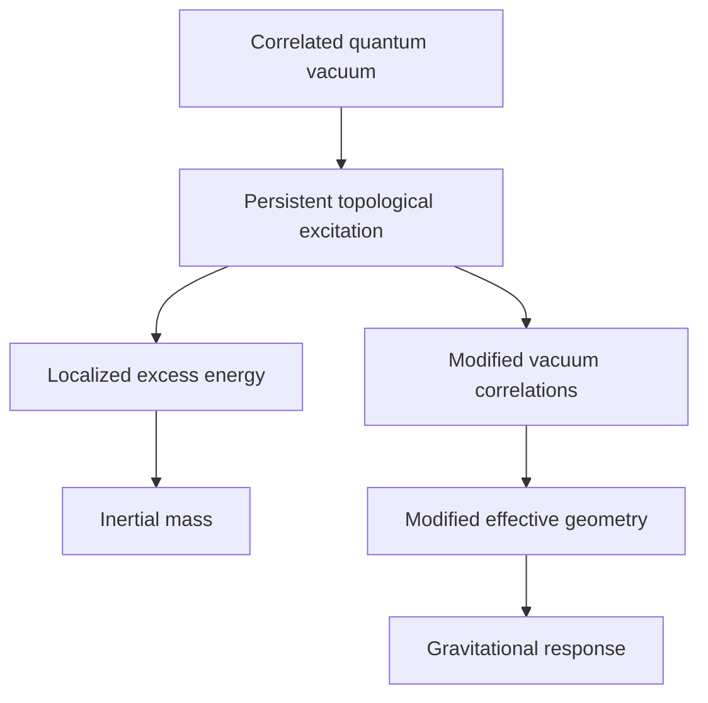

# Candidate models for the next phase — gravity and its source

**Research discussion, 2026-11-21.** ChatGPT response to Richard (PI), following EX-GC26C/D/F and the decision to have Claude run EX-GC26E3. Archived for discussion, not a registered experiment. The diagrams below are conceptual, not simulation data; literature illustrations in the original chat are represented by their descriptions and source links.

## Richard's prompt (verbatim)

> I am very impressed with your ability to keep the "big picture" in context for this new physics investigation. I'll have Claude AI do the GC26E3 test, but I would like you to provide a few candidate alternatives topological particle models based on what you have seen so far that may provide positive outcomes for the next phase of our investigation. The key outcome is to identify the mechanism of gravity and it's source. Keep in mind that we want to include any speculative ideas that entanglement, ZPF, or other speculative concepts are included in our thinking.

## ChatGPT response

Richard, thank you. I find this next phase particularly interesting because we are now in a position to make some informed speculative leaps. We have experimental results that can guide the speculation.

My principal recommendation is that we turn the investigation around:

**Instead of starting with a gravitational field and asking how particles interact with it, start with a physical vacuum capable of supporting particles and ask whether gravity emerges from the vacuum's response to those particles.**

That would be much closer to our original ambition.

### Candidate models

| Candidate | Particle structure | Potential gravitational mechanism | Priority |
|---|---|---|---|
| Faddeev–Skyrme | Knotted field | Deformation of the surrounding field | High |
| Dynamical vacuum-scale model | Knot with vacuum polarization | Local change in vacuum properties | Highest |
| Coupled gauge-field knots | Linked field flux | Collective field response | Medium |
| Zero-point fluctuation model | Topological vacuum defect | Altered fluctuation spectrum | High, speculative |
| Entanglement geometry model | Correlated topological excitation | Change in vacuum correlation geometry | Exploratory |

These need not be mutually exclusive. Ultimately, some may turn out to describe different aspects of the same underlying mechanism.

### Candidate 1 — Faddeev–Skyrme topological knots

This is the most natural alternative to our present Skyrmion construction.

Instead of a four-component field constrained to a three-sphere, the Faddeev–Skyrme model uses a three-component unit vector field $\mathbf n(\mathbf x,t)\in S^2$. Its topology is characterized by an integer Hopf invariant. Its stable configurations can form twisted rings, linked loops and actual knots. Faddeev and Niemi demonstrated this possibility in three-dimensional classical field theory [1].

**Why it interests me:** It offers a potentially rich particle spectrum arising from different topological configurations within one common field.

We could investigate untwisted and twisted rings, linked rings, trefoil knots, bound composites and opposite handedness configurations, all without introducing separate laws for each particle.

**Gravity investigation:** Initially, I would not introduce a Nordström gravitational field. I would measure the natural deformation of the field surrounding each relaxed knot and ask:

- Does it contain a long-range monopole component?
- Does its strength correlate with rest energy?
- Does it distinguish between particles and their opposite-handed counterparts?
- Can two knots attract independently of their orientation?

The ordinary Faddeev–Skyrme model does not guarantee any of these gravitational properties. Its natural interactions can be orientation-dependent. That is precisely why these measurements would be informative.

*Recommended numerical candidate. Visual reference: Hopfion rings, links and trefoils in [1].*

### Candidate 2 — A dynamical vacuum-scale field

This is my favorite candidate for investigating the actual source of gravity.

Imagine that the vacuum possesses a local property that determines the energetic cost of deforming it. Call that property $\chi$.

A topological particle is formed from one field, but its existence also modifies the local vacuum scale $\chi$.

There are established precedents for coupling Skyrmions to scalar fields that determine the local energy scale, including dilaton-based models [2].

**The proposed mechanism:** Suppose the particle energy depends on the asymptotic vacuum scale, $E=E(\chi_\infty)$. Its integrated scalar sourcing can then be related, under appropriate equilibrium conditions, to its energy sensitivity:

$$S_\chi=\frac{\partial E}{\partial\chi_\infty}.$$

If every stable particle configuration naturally satisfies

$$\frac{\partial\ln E}{\partial\chi_\infty}=\text{constant},$$

then its scalar sourcing is proportional to its energy. That is exactly the relationship we have been looking for.

**My proposed experiment:** Before building any gravitational dynamics:

1. Construct several stable knots.
2. Change the uniform background vacuum scale slightly.
3. Re-relax each knot.
4. Measure the resulting change in rest energy.
5. Compare their normalized energy sensitivities.

If the sensitivity is universal across topologies, bound configurations and excited states, we have identified a promising underlying mechanism. We would then investigate whether the vacuum-scale field supports a stable massless mode, giving rise to a long-range $1/r$ response.

The important caveat is that a universal rescaling of all particle energies can itself be imposed mathematically. The deeper discovery would be explaining why the microscopic vacuum dynamics enforce that scaling.

*My highest priority.*

### Candidate 3 — Coupled gauge-field knots

Another possibility is that particles are knots formed by coupled fields carrying circulating flux.

A particularly interesting research direction is the relationship between ordinary scalar and gauge fields and effective Faddeev–Skyrme models. Researchers have demonstrated constructions in which Faddeev–Skyrme dynamics arise as a low-energy limit of a more fundamental gauge-field theory [3].

Rather than inserting a quartic stabilizing term directly, it may be possible for the stabilizing behavior to arise from interactions between simpler fields. This could explain why stable topological particles form, why they have finite sizes, why they possess internal circulating energy, and whether additional interactions emerge from the same fields.

I would also watch for naturally emerging chirality, polarization and angular momentum, without prematurely identifying those properties with quantum spin.

The principal difficulty is that ordinary vector-mediated interactions can distinguish signs and produce repulsion. Gravity appears to couple universally to energy, so we would need a mechanism beyond conventional gauge charge.

This is a promising particle-construction candidate, although not my first choice for identifying gravitational sourcing.

### Incorporating the more speculative ideas

I agree that we should actively consider zero-point fluctuations and entanglement. However, I would want to formulate them as distinguishable, testable hypotheses.

### Candidate 4 — Gravity from zero-point field fluctuations

I have wondered whether the original Model Gc depletion mechanism was pointing at something real, but representing it in the wrong physical form.

Instead of a particle consuming carriers from a vacuum, suppose a topological particle changes the allowed fluctuation modes of the vacuum around it.

The particle would not be continuously absorbing energy. It would instead impose a persistent modification of the vacuum's equilibrium state.

There is a historical precedent for considering quantum vacuum fluctuations as the origin of gravitational dynamics in Sakharov's induced-gravity proposal [4].

**The initial experiment:** Calculate the small-amplitude normal modes of three configurations: empty vacuum, vacuum containing one stable knot, and vacuum containing two knots.

Compare the appropriately regularized fluctuation energies,

$$\Delta E_{\rm ZPF}=\frac{\hbar}{2}\sum_n(\omega_n^{\rm knot}-\omega_n^{\rm vac}).$$

For two particles, the interaction contribution would be

$$U_{\rm vac}(d)=E_{\rm ZPF}^{(12)}(d)-E_{\rm ZPF}^{(1)}-E_{\rm ZPF}^{(2)}+E_{\rm ZPF}^{(0)}.$$

The derivative of that energy determines an effective force.

**What would excite me:** Finding an attractive interaction that approaches

$$U_{\rm vac}(d)\propto-\frac{E_1E_2}{d}$$

without inserting that relationship into the model.

That would simultaneously suggest a gravitational source mechanism and an explanation for the inverse-square force law.

Ordinary vacuum fluctuation forces do not generically have this distance dependence or universal energy coupling. We must therefore regard this as a speculative candidate, not a consequence already established by zero-point physics.

A first calculation could be performed using small lattices and normal-mode analysis, avoiding expensive full quantum simulations.

### Candidate 5 — An entangled vacuum with topological defects

I find this the most conceptually ambitious direction.

Perhaps the vacuum is not adequately described as a collection of independent local field values. Instead, it could be a highly correlated quantum state, with a particle representing a persistent topological modification of those correlations.

A potentially relevant precedent is Ted Jacobson's work connecting vacuum entanglement equilibrium with the Einstein field equations under particular physical assumptions [5].

**My speculative hypothesis:** The existence of a particle modifies the vacuum correlation structure. That modification changes the effective geometry experienced by other particles. Gravity would then be a consequence of the collective organization of the vacuum, rather than a conventional force exerted by a substance.

**How could we investigate this?** I would start with a simplified quantized harmonic lattice around a classical topological solution.

Compare the vacuum correlation functions and entanglement entropy of regions containing no particle, one particle, a bound composite, and an internally excited particle.

We would look for a reproducible relationship between the redistribution of correlations and the independently measured energy of the particle.

One must be careful here: classical correlations are not quantum entanglement, and entanglement alone does not provide a mechanism for transmitting forces or signals.

Nevertheless, this could give us a computationally accessible entry point into a much deeper question.

### A unifying hypothesis

There is a connection between these candidates that I find intriguing.

Perhaps a particle is best understood not as an entity immersed in the vacuum, but as a stable, localized state **of the vacuum itself**.

Its energy is the energetic cost of maintaining that state.

Its inertia is the resistance associated with transporting that state.

Its gravity is the response of the surrounding vacuum to the existence of that state.

We could formulate that as a working research hypothesis, with no commitment yet to whether the underlying response is classical, quantum, geometric or informational.

### What any successful candidate must explain

| Requirement | Why it matters |
|---|---|
| Stable localized topology | Persistent particles |
| Conserved energy and momentum | Genuine inertia |
| No preferred vacuum rest frame | Absence of intrinsic drag |
| Universal gravitational sourcing | Equivalence principle |
| Binding and internal energy contribute | Composite-body universality |
| Long-range inverse-square attraction | Newtonian limit |
| Causal propagation | Relativistic consistency |
| Response to electromagnetic radiation | Beyond scalar gravity |

The last item is particularly important. A massless spin-2 gravitational interaction has powerful theoretical connections to universal energy-momentum coupling, as Weinberg demonstrated under relativistic scattering assumptions [6].

Ultimately, we will need to investigate whether the vacuum produces an effective tensor geometry rather than only a scalar potential.

### My recommended next research program

I would establish two parallel research paths.

**Path A — Conservative topological particles**

- EX-GC27A: Construct and relax Faddeev–Skyrme knots.
- EX-GC27B: Measure their energy, inertia and natural far-field structure.
- EX-GC27C: Investigate sensitivity to a dynamical vacuum-scale field.
- EX-GC27D: Test whether gravitational sourcing tracks energy across configurations without species-specific calibration.

**Path B — Quantum vacuum response**

- EX-GC28A: Measure fluctuation spectra around a stable topological particle.
- EX-GC28B: Test fluctuation-induced interactions between two particles.
- EX-GC28C: Examine quantum vacuum correlations and entanglement modifications.
- EX-GC28D: Investigate whether these modifications admit an effective gravitational field description.

I would keep both paths exploratory, with early inexpensive tests designed to eliminate unproductive hypotheses.

**If I had to choose just one experiment to start with, it would be the vacuum-scale energy-sensitivity test.** It offers a relatively inexpensive way to investigate whether the source of gravity can be understood as a fundamental property of how particle energy depends on the vacuum.

If successful, it could provide the bridge between our classical topological particle work and the more speculative ZPF and entanglement investigations.

## Follow-up PI direction

> I think your response is probably the most important and insightful that I have seen in a long time. Can you put this response with the prompt I gave you into the /paper part of the repo as Candidate_Models_next_phase. I have always had a bias toward the Sakharov interpretation (vacuum link) and like Candidate 2 and 4 so would lean toward doing those first. Doing the vacuum-scale sensitivity test would be a good start. Can you outline that test?

Priority changed accordingly: start with the existing Skyrme reference states rather than requiring a new Faddeev–Skyrme solver first. See [vacuum-scale sensitivity outline](../spec/EX-GC27_vacuum_scale_outline.md). This is an outline for discussion, not run authorization.

## Literature referenced in the discussion

1. Faddeev and Niemi, [Stable knot-like structures in classical field theory](https://doi.org/10.1038/387058a0) (1997).
2. Ponciano and García Canal, [Approximate solutions for the single soliton in a Skyrmion-type model with a dilaton scalar field](https://doi.org/10.1103/PhysRevC.72.065206) (2005).
3. [Revisiting the Faddeev-Skyrme model and Hopf solitons](https://doi.org/10.1103/PhysRevD.88.045026) (2013).
4. Sakharov, [Vacuum quantum fluctuations in curved space and the theory of gravitation](https://ayuba.fr/pdf/sakharov_qvf.pdf) (1967/1968).
5. Jacobson, [Entanglement equilibrium and the Einstein equation](https://arxiv.org/abs/1505.04753) (2016).
6. Weinberg, [Photons and Gravitons in S-Matrix Theory](https://doi.org/10.1103/PhysRev.135.B1049) (1964).
