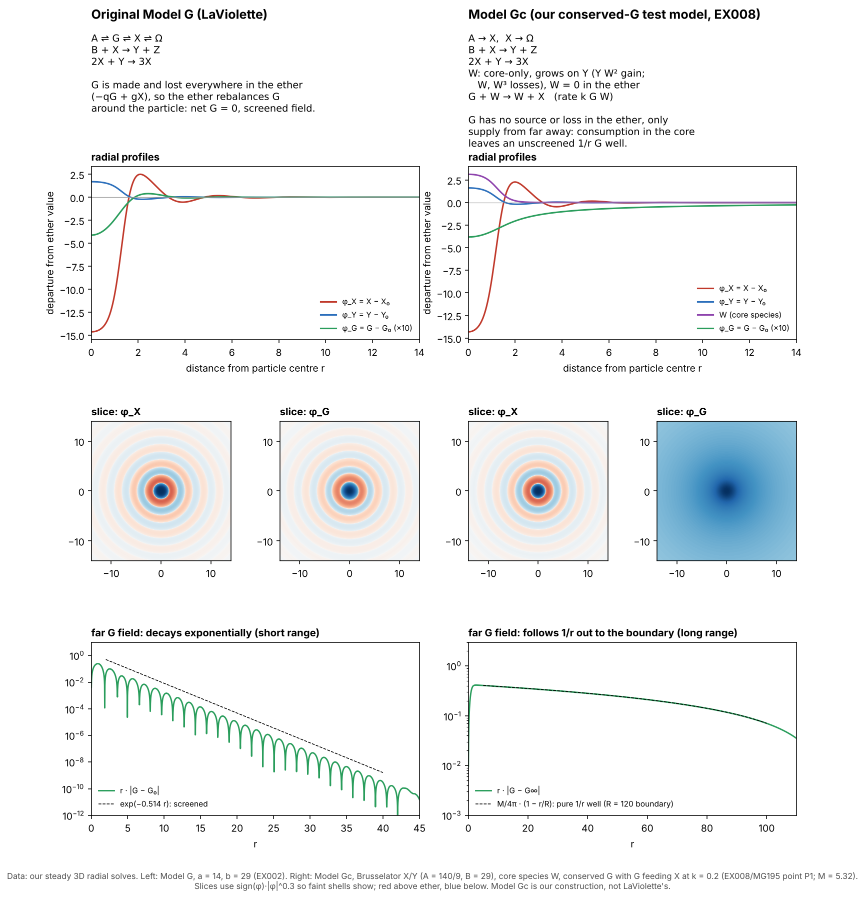
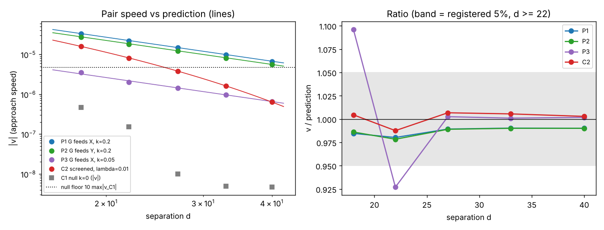
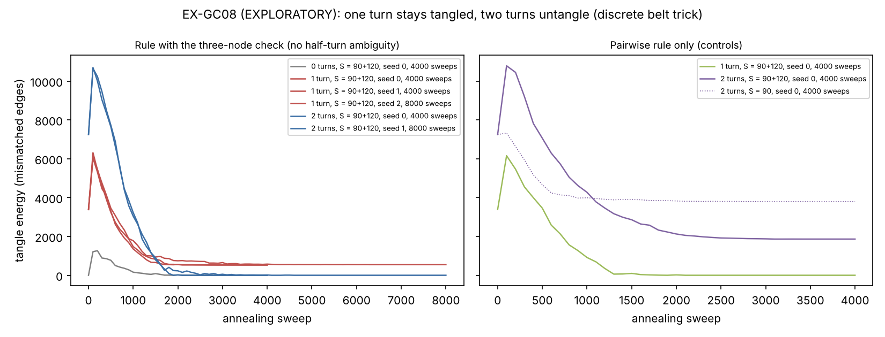
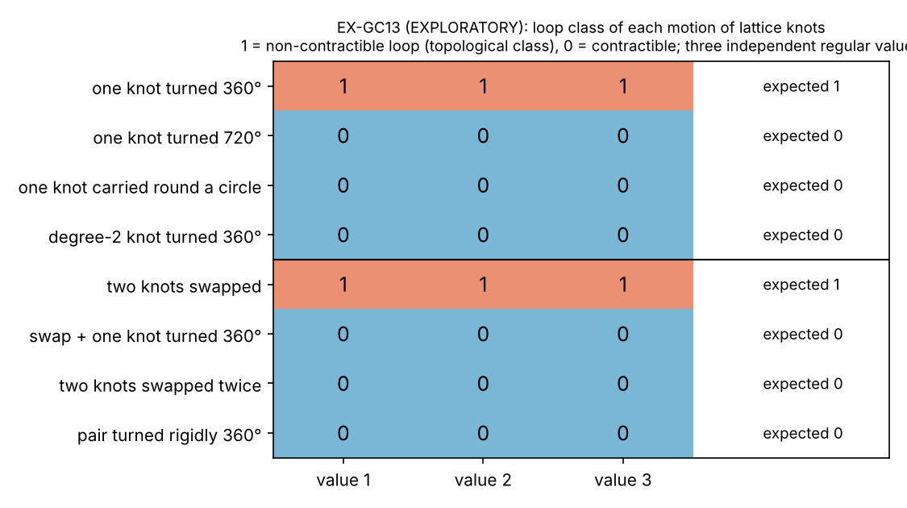
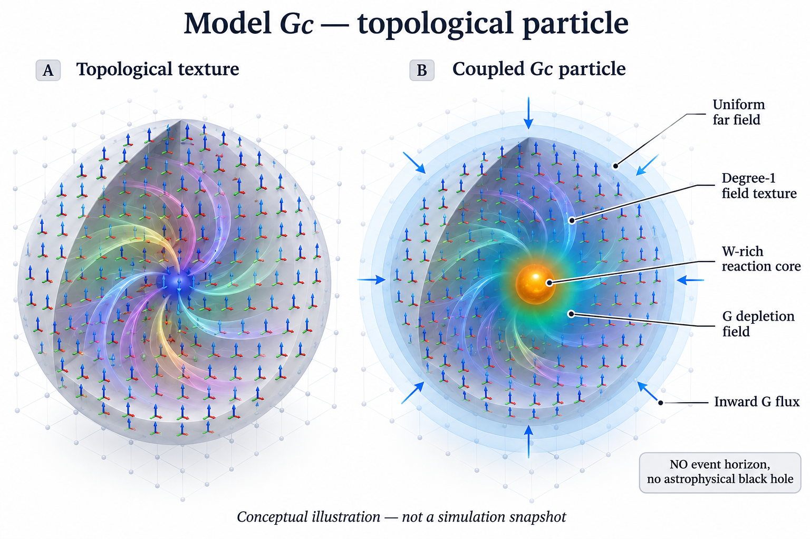
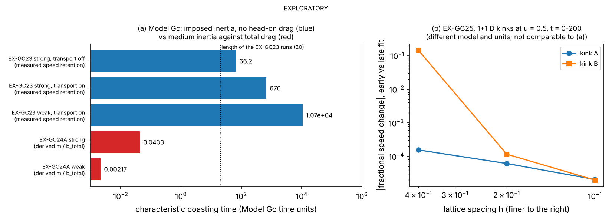
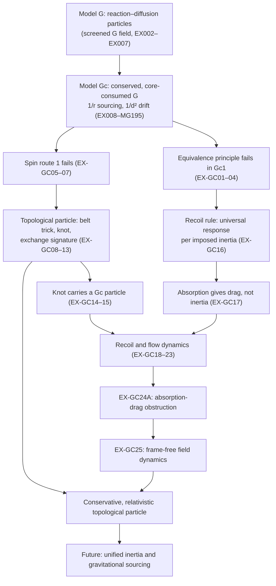

# Model Gc: An Investigation of Emergent Gravity, Particle Topology and Inertia

### From reaction–diffusion particles to relativistic topological field configurations

**Version 0.3, frozen 2026-11-20: documents the research through EX-GC25.** PI: Richard Benear. Drafted by Claude
(Anthropic) from the records in this repository and revised after two rounds of review by ChatGPT, both endorsed by the
PI; the changes are listed in Appendix C. Earlier drafts are kept unchanged (`paper/Model_Gc_white_paper_draft_v0.1.md`,
`paper/Model_Gc_white_paper_draft_v0.2.md`). Further revision is deferred until EX-GC26 produces results.

Every result below except MG195 is EXPLORATORY under `RESEARCH_PROTOCOL.md` and supports no claim on its own. Model
Gc, its variants, the lattice rules and the couplings are our construction, not Paul LaViolette's. Each statement
points to the record it rests on; Appendix A lists the studies.

**How claims are labelled.** *Demonstrated* means measured in a simulation or calculation and checked against a
prediction. *Imposed* means put into the model by design (an assumption, an assigned parameter or a chosen coupling).
*Interpretation* means a reading of the results that goes beyond what was measured.

**Notation.** S = ∫kGW dV is a particle's G consumption rate (written M in the earlier study notes). M_i is inertial
mass. D_G is the diffusion constant of G. m₀ is the absorption rate of one recoil unit (EX-GC16, 17).

---

## Abstract

We asked whether particles built as localized reaction–diffusion structures, in the spirit of LaViolette's Model G,
can show gravity, the equivalence principle, spin-like behaviour and Newtonian inertia, and whether these survive on a
discrete lattice of tokens.

- **Gravity.** Model G has no long-range gravity: its bulk reactions screen the G field exponentially, and an
  integral identity also makes a stationary particle's net G disturbance vanish. We therefore built Model Gc, in which a carrier G is conserved and consumed only inside particle
  cores. *Demonstrated:* a true 1/r field, and a particle drift velocity toward lower G that falls off as 1/d², supported
  at 1–2% by a registered study (MG195). This is an inverse-square drift law, not Newtonian gravitational acceleration.
- **Equivalence principle.** In the original model, free fall depends on particle type and binding. *Demonstrated:* a
  recoil rule, with each absorber pushed by the tokens it absorbs, gives a universal response per unit of *imposed*
  inertia in the weak regime.
- **Topology.** *Demonstrated:* a degree-1 knot of lattice frames under a local three-node rule is stable, keeps its
  topological degree exactly, has a non-contractible 360° loop and a contractible 720° loop, and has the
  Finkelstein–Rubinstein exchange signature. The knot can carry a Gc particle that sources the 1/r field and drifts at
  the correct rate. This is classical topology, not quantum spin.
- **Inertia.** Absorbing a carrier from a medium at rest produces drag, not inertia. A flow field lets the particle
  coast as one body, but its inertia is *imposed* (τ = 20). The inertia the medium itself generates gives coasting times
  of 0.043 (reference particle) and 0.0022 (weak particle) time units under the assumed absorption-drag law, against the
  20-unit runs of EX-GC23. It also scales as S², while gravitational sourcing scales as S.
- **Frame-free direction.** *Interpretation:* gravity from net consumption of a conserved carrier defines a medium
  rest frame, and that rest frame causes the drag. A 1+1 D check shows that conservative kinks coast, and that kinks
  coupled to energy through an external scalar potential fall alike while other couplings do not. Whether a
  self-gravitating, frame-free topological particle works is open, and we propose a gated sequence of tests.

---

## Principal findings

| Finding | Status | Evidence |
|---|---|---|
| Long-range (1/r) gravitational sourcing and an inverse-square drift law can arise from localized particle structures with a conserved, core-consumed carrier | Demonstrated; one registered study | EX008–EX010, MG195, EX-GC09 |
| Classical spin-like topology (360°/720° loops) and an exchange signature can coexist in a lattice particle that also carries a gravitational source | Demonstrated (classical) | EX-GC08, EX-GC12–15 |
| Rest-frame absorption drag obstructs Newtonian motion in the tested model | Demonstrated under the assumed drag law | EX-GC17–24A |
| Conservative, relativistic field configurations are a promising alternative | Proposed; 1+1 D external-potential check only | EX-GC25 |

---

## 1. Background and motivation

**Model G and the hypergraph programme.** LaViolette's Subquantum Kinetics describes particles as Turing-type
dissipative structures in a reaction–diffusion "ether" (Model G). The parent repository (RichardBenear/ModelG) mapped
Model G onto discrete token and hypergraph rules and tested, under pre-registered gates, whether the rules reproduce
Model G's particles. The long-term aim is a link to quantum mechanics and gravity, which is why causal invariance of
the rule set matters (Wolfram 2020).

**Why Model G has no long-range gravity.** Two separate findings from the parent programme (EX002) matter here.
- **Screening.** The bulk reaction terms of Model G (G is made and lost everywhere in the ether) give the G field a
  finite decay rate: a particle's G tail decays as e^(−0.514r)/r. This is what removes long-range gravity. A broadened-core
  variant that did produce a net G deficit (−1.84) still had the same exponential tail.
- **Zero net disturbance.** The rate equations also imply the identity (q − g·p)∫φ_G = 0 in any dimension, so a
  stationary particle of the original model has no net G disturbance at all.
 Near-marginal ethers (EX003), growth (EX004) and variants (Model G-2 and a
hybrid; EX005–EX007) gave only screened wells, some repulsive and some weakly attractive (`docs/lineage/`).
LaViolette's 1/r gravity assumes a net, unscreened exterior G deficit; the bulk reactions screen it, and the identity
rules out a net deficit for stationary particles of the original model.

**The design that followed.** Within a diffusion-based construction, a 1/r field in 3D needs a carrier with no bulk
source or loss (so nothing screens it) and a net sink inside the particle. That is Model Gc. This is not the only route
to a 1/r field: EX-GC25 (Section 7) points to a lossless field disturbed by the particle, with no consumption.



**Figure 1.** Model G versus Model Gc particles (steady 3D radial solves, EX002 and EX008). Left: in Model G the far G
field oscillates and decays exponentially (screened). Right: in Model Gc the far field follows S/(4π D_G r) out to the
boundary.

---

## 2. Model Gc

Definition: `spec/MODEL_Gc.md`. Gc1 (gravity only):

```
X_t = D_X ∇²X + A − (1+B)X + X²Y + c_x k G W
Y_t = D_Y ∇²Y + B X − X²Y + c_y k G W
W_t = D_W ∇²W − W + c Y W² − W³
G_t = D_G ∇²G − k G W
```

X and Y form a Brusselator ether (A = 140/9, B = 29, D_Y = 12). W is a core species that is zero in the ether
(c·Y₀ = 1.86 < 2) and is sustained inside a particle. G is conserved in the bulk, held at G∞ = 1 far away, and consumed
only where W is present; consumed G feeds X or Y. Outside the core, D_G ∇²G = 0, so

  G(r) = G∞ − S / (4π D_G r),  with S = ∫kGW dV.

All Gc1 studies used D_G = 1 unless stated; the wave-medium studies (EX-GC20 to 24) used other effective diffusion
constants. Gc2 adds a conserved signed carrier C and two core types that make or consume it, as a charge analogue
(EX010).

---

## 3. Gravitational sourcing and the inverse-square drift law

| Study | Result | Record |
|---|---|---|
| EX008 | Stable 3D particle. Far field G∞ − S/(4πr) to 1e-6, independent of domain size. Linear response: the particle drifts toward lower G. | `results/EX008_longrange/` |
| EX009 | Direct axisymmetric pair solve: approach speed 0.984–0.986 of the 1/d² prediction at d = 20–30. Short-range Turing repulsion near d ≈ 8. Interaction ∝ k², 1/r range down to k = 0.001. | `results/EX009_followups/` |
| EX010 | Gc2: tuned mirror charges repel/attract as like/unlike. With G added, every type drifts toward lower G; mobilities within 1–2%. Reciprocity is tuned at one point, not built in. | `results/EX010_charge_gravity/` |
| **MG195** (confirmatory, PI closed) | Registered in advance. **P1, P2 SUPPORTED** (v/prediction 0.98–0.99, fitted exponent 1.98). **C2** (Yukawa control) **PASS**. **P3 UNRESOLVED**: at weak coupling (k = 0.05) the registered null floor, set by a short-range Turing tail in the k = 0 null control, exceeded every P3 predicted signal. | `results/MG195_inverse_square/` |
| [EX-GC09](https://github.com/RichardBenear/Model-Gc/tree/main/results/EX-GC09) | On a 3D lattice (h = 0.5), as whole tokens, the far G deficit matches the lattice point-sink field within 1–4%. Survives at Ω = 1000 (S −6%) and 300 (−20%) over T = 30, fades at 100, dies at 30: about 10⁴ core tokens needed. | `results/EX-GC09/` |

**What this establishes and what it does not.** Gc particles are overdamped: they move at a velocity proportional to
the local G gradient. MG195 therefore establishes v ∝ 1/d², the spatial law of the interaction. It does not establish
a ∝ 1/d², which would need particles with inertia (Section 6).



**Figure 2.** MG195: pair approach speed against the 1/d² prediction (left) and the ratio (right; band = registered
5%, scored at d ≥ 22). P1 and P2 lie at 0.98–0.99. P3 (k = 0.05) lies below the registered null floor (dotted line, left)
at every separation, so it is the registered UNRESOLVED case; it also leaves the band at d = 18–22. C2 is the screened (Yukawa) control.

*(Interpretation.)* Model Gc's gravity is a sink-flow (Le Sage-like) mechanism: the field is a steady inflow of a
conserved carrier toward consumers. This is what gives true 1/r range, and, as Section 6 shows, also what causes the
inertia problem.

---

## 4. The equivalence principle

### 4.1 In Gc1, free fall depends on particle type and binding

| Study | Result | Record |
|---|---|---|
| [EX-GC01](https://github.com/RichardBenear/Model-Gc/tree/main/results/EX-GC01) | v_i = μ_i S_j/(4πd²) within 1–2%. S_a v_a = S_b v_b only when mobilities match; a particle with doubled k falls 1.8× faster. | `results/EX-GC01/` |
| [EX-GC02](https://github.com/RichardBenear/Model-Gc/tree/main/results/EX-GC02) | *Demonstrated:* an effective inertial response from internal core dynamics. A slow core species makes the drag fall linearly with its response time, and a direct time response confirms an effective mass. It needs tuning near a type-dependent threshold (17.5–40), so free fall is not universal. | `results/EX-GC02/` |
| [EX-GC03](https://github.com/RichardBenear/Model-Gc/tree/main/results/EX-GC03) | Active and passive gravitational coupling agree within 5%, but drag is set by the shared X/Y core, so drift speeds spread 35%. Tuning a slow G brings this to 4–5%, only by tuning. | `results/EX-GC03/` |
| [EX-GC04](https://github.com/RichardBenear/Model-Gc/tree/main/results/EX-GC04) | Identical particles bind at d = 7.145 (and 10.11); the bound pair drifts at 0.939 (0.972) of a single particle's speed because consumption depends on local G (dS/dG = 4.58). | `results/EX-GC04/` |

### 4.2 The recoil rule: a universal response per unit of imposed inertia

EX-GC16 replaced G-dependent consumption with fixed-rate absorbers that are pushed along the arrival direction of the
tokens they absorb (token lattice, Ω = 1000 tokens per site). The particles were held stationary while the recoil
force was measured, and inertia proportional to the number of absorbing units was *imposed*.
- **Weak regime.** Five particle types had a recoil response of m₀E/3 per unit of imposed inertia (m₀ = 50, local
  depletion about 1%). Four agreed within 0.3–0.4%. The double-rate type was 1.8% high, within its statistical
  uncertainty (±5.7%, 1 SEM). The EX-GC16 note's summary "within 0.2–0.5%" overstated this for that type.
- **Pairs.** Two absorbers felt equal and opposite forces. These matched the lattice mean-field prediction within 1–3%
  at d = 2–4 and 9–11% (1σ) at d = 6–8; the prediction tends to m₀²/(12πΩd²). The source strength and the response
  strength are the same number, m₀.
- **Strong regime.** At m₀ = 500 (13% depletion) the response was 2–7% above m₀E/3, ordered by how concentrated the
  consumption is, as the mean field predicts. This is a self-energy (Nordtvedt-type) violation that scales as m₀/Ω.

This is a universal recoil response, not yet an independently derived equivalence principle, because the inertia was
imposed. Record: `results/EX-GC16/`.

---

## 5. Topological origins of spin-like behaviour and exchange statistics

### 5.1 Route 1, a rotating particle: did not work
No non-round core mode of Gc1 oscillates (EX-GC05). A slow core inhibitor ("Gc3") gives a breathing clock, not
rotation (EX-GC06), and in 3D time runs the breathing grows until the core collapses (EX-GC07). Each fix adds another
tuned ingredient.

### 5.2 Route 3, structure in the lattice
- **Belt trick (EX-GC08).** Each node carries one of the 24 rotations of a cube plus an SU(2) "lift" (48 elements).
  A local three-node no-cut rule (short lifts must compose around every triangle) gives a conserved Z₂ index: one turn
  stays tangled, two turns untangle. Pairwise rules leak or freeze.
- **Tokens and tether (EX-GC09, EX-GC10).** With the particle tethered by its own G supply, a one-turn twist collects
  next to the core and lowers S by 7.9%; two turns untangle (S within 0.6%). The twist is imposed by hand and the
  coupling strength is chosen.
- **No exchange sign from a tether (EX-GC11).** The frame-field tether has no identity (paths through it can be redrawn
  around a core), so swapping particles changes nothing. A field version of spin–statistics needs the particle itself to
  be a topological soliton.



**Figure 3a.** EX-GC08: discrete belt trick. With the three-node rule, a one-turn twist stays tangled and two turns
anneal to zero (left); pairwise rules fail (right).

### 5.3 The particle as a knot
- **A stable lattice knot (EX-GC12).** A degree-1 texture (a "hedgehog" rounded to the 48 lifts) relaxes under the
  three-node rule to a compact knot of about 150 mismatched edges. Its degree stays exactly 1. Under a pairwise rule it
  unwinds. Two same-sign knots keep degree 2.
- **Exchange signature (EX-GC13).** Each loop of configurations was classified by its topological class (Figure 3b).
  A 360° turn and a swap of two knots are both non-contractible; a 720° turn, swap plus 360°, and a degree-2 knot turned
  by 360° are contractible. All 24 computations agree with Finkelstein & Rubinstein (1968), and each loop can be carried
  out on the lattice by allowed moves.
- **The knot as a Gc particle (EX-GC14, EX-GC15).** W autocatalysis is gated by the smoothed knot density, and the knot
  is pulled toward W (energy −λΣWρ); both couplings are *imposed*. The knot carries a stable Gc particle that sources the
  1/r field (within 0.1% of a lattice point sink); without a knot the particle dies. At h = 0.25 the knot particle
  drifts at −4.998×10⁻⁴, identical to a plain Gc particle to four digits and within 2% of the continuum value. Without
  the pull (λ = 0) the knot shrinks and the particle dies.



**Figure 3b.** EX-GC13: topological class of each loop, for three independent regular values (1 = non-contractible,
0 = contractible). The swap of two knots falls in the same class as a 360° turn of one knot. Made by
`src/whitepaper_figures.py` from the EX-GC13 records.



**Figure 4.** Conceptual illustration (not simulation data) of the topological particle. (A) The degree-1 frame
texture. (B) The coupled Gc particle: a W-rich reaction core inside the texture, consuming G, with the G depletion field
and the inward G flux around it. In EX-GC14/15 the knot gates the core's autocatalysis and is pulled toward the
core.

**How the knot rule works.** Moves are proposed at random and accepted by a Metropolis test on a mismatch count
(neighbour pairs holding different rotations) at temperature 0.6, in checkerboard order. The starting knot is built by
hand. The rule is local and stochastic, not a deterministic rewriting rule, and has not been tested for causal
invariance (`src/exgc12_soliton.py`, `src/exgc14_knotgc.py`).

### 5.4 What is and is not shown

| Property | Demonstrated? |
|---|---|
| Degree-one topological structure | Yes |
| Conserved topological degree | Yes, under the tested rules |
| Non-contractible 360° rotation loop | Yes |
| Contractible 720° rotation loop | Yes |
| Topological exchange signature (swap in the same class as a 360° turn) | Yes |
| Intrinsic angular momentum ħ/2 | No |
| Quantum exchange phase of −1 | No |
| Physical fermionic statistics | No |

The correspondence with Finkelstein–Rubinstein topology is substantial, but no quantum particle has been constructed.
Turning the classical loop class into a phase would need a quantum version of the rule.

---

## 6. The inertia investigation

### 6.1 Absorption gives drag, not inertia (EX-GC17)
A particle moving through the token gas meets more tokens from ahead. Per unit of imposed inertia the resulting drag is
γ ≈ m₀/6 (within 1–2% at m₀ = 50). Because drag and the gravitational push both come from absorption, the terminal
drift speed is universal (within ±2% of 2E, even where the push alone differs by 7%). The response to acceleration has
the wrong sign for inertia (κ/γ ≈ 0.01–0.07, anti-inertial). So the medium gives Aristotelian, not Newtonian, motion.
*(Interpretation.)* This is the classic objection to Le Sage-type gravity, found here in a concrete model.

### 6.2 Moving the particle as one body
- **EX-GC18 (failed).** Applying the recoil to the knot tears it off the core; pushing W locally squeezes the core. A
  reaction–diffusion pattern has no variable that carries momentum.
- **EX-GC19.** A flow field V, carried by the pattern, lets the particle accelerate as one body; K = 0.2 and 0.4
  particles accelerate within 4%. Cohesion is needed or the core is crushed. The knot cannot keep up.
- **EX-GC20/21.** G as a wave (telegraph equation); a knot carried with the flow stays within one lattice step.
- **EX-GC22 (ChatGPT).** Most of the coasting loss in EX-GC19/20 was a defect of the flow model: the transport term
  (V·∇)V was missing. Our earlier "accretion drag" interpretation was withdrawn and errata were added.
- **EX-GC23 (ChatGPT).** With (V·∇)V the particle coasts. The strong particle keeps 97.06% of its internal speed over
  20 units (73.91% without the term), and its core travels 0.963 of the ideal distance; a weak particle keeps 99.81%.
  A 2.5% slip remains. The inertia is *imposed* (τ = 20), and the head-on absorption drag of Section 6.1 was switched
  off.

### 6.3 The medium's own inertia under the assumed absorption-drag law (EX-GC24A, ChatGPT)
For a prescribed source moving through the wave medium, the reactive (added) mass is positive when damping is weak and
negative when it is strong, consistent with the anti-inertia of EX-GC17. Two values should be kept apart. The analytic
lossless mass in an infinite domain is S²/(6π^{3/2}c²σ) = 0.265 at the reference settings. The reactive coefficient
measured in the finite box (L = 32, τJ = 20, ω = 0.003) is 0.231, and 0.2312 with the actual 1/G weighting; the
coasting times below use the latter. Combined with the head-on drag b = S inherited from EX-GC17, the
characteristic coasting time m/b_total is 0.0433 time units for the reference particle (S = 5.32) and 0.00217 for a
weak one (S = 0.266). The EX-GC23 runs lasted 20 units, and with imposed inertia the particle kept 97% of its speed over
that time. The added mass also scales as S² while gravitational sourcing scales as S, so it could not be a universal
mass.

This is a **conditional negative**: it holds under the assumed absorption-drag law and for a prescribed source. It does
not rule out every possible form of field-generated inertia. Records: `results/EX-GC24/`,
`review/EX-GC24A_claude_review.md`.



**Figure 5.** (a) Characteristic coasting times in Model Gc, from two different measures. Blue: EX-GC23, inferred from
measured speed retention with imposed inertia and no head-on drag (time = −20/ln(speed retained over 20 units)).
Red: EX-GC24A, derived from the reactive-mass-to-total-drag ratio m/b_total. (b) EX-GC25: measured fractional speed
change of 1+1 D kinks against lattice spacing. Panel (b) is a different model in different units and is shown only to
show the trend with resolution, not as a coasting time comparable with (a). Made by `src/whitepaper_figures.py` from
the committed records.

---

## 7. The rest-frame obstruction and a frame-free alternative (EX-GC25)

### 7.1 Why consumption-based gravity needs a rest frame
A conserved carrier has a density and a flux that form one four-vector. A uniform background density is that vector
pointing purely in time, which is true in one frame only. A particle moving through it at speed u meets a flux G∞u,
and absorbing that flux costs momentum. This is the drag of Section 6.1. Within the net-absorption mechanism studied here
(a conserved carrier drawn from a uniform background), no choice of medium dynamics removes it. *(Interpretation.)*
In that mechanism, gravity from net absorption and Newtonian inertia without a preferred frame are incompatible. Other
mechanisms are not excluded by this argument.

### 7.2 A frame-free design principle
- A constant scalar field value is the same in every frame. If G is a scalar field with vacuum value G∞ and a lossless
  wave equation, a particle disturbs it, and the static disturbance obeys Laplace's equation, so a 1/r field is
  possible. Like sources of a scalar field attract.
- A particle in uniform motion would carry a Lorentz-contracted copy of its field, with nothing to drag on.
- If G couples to the particle's energy (the trace of its energy–momentum tensor, Nordström 1913), von Laue's theorem
  makes the gravitational source strength of any stable, localized, static object equal its rest energy, which is its inertial
  mass. This would hold for every particle type and for bound composites including their binding energy, and would
  answer Section 4.1.

Universal energy coupling is a **design principle** here, not an emergent result: it is chosen, and the theorem then
guarantees universality.

### 7.3 What EX-GC25 demonstrated (1+1 D)
Relativistic φ⁴ kinks stood in for particles; they are not Gc particles.
- **External potential, energy coupling.** Four kinks with rest energies 8× apart fell at 0.9987–0.9995 of the predicted
  universal rate.
- **External potential, other coupling.** With a source strength not tied to energy, fall rates spread by a factor of 16,
  matching Q/M within 0.8%.
- **Coasting.** Launched at half the wave speed with no potential, kinks lost 2×10⁻⁵ to 2×10⁻⁴ of their speed over 200
  time units, shrinking with lattice spacing. A kink only 1.8 lattice spacings wide lost 14%: the lattice itself is a
  rest frame.

It did **not** demonstrate a particle generating its own gravitational field, carrying that field while moving, or
interacting gravitationally with another particle. Record: `results/EX-GC25/`, figure
`paper/figures/exgc25_framefree.png`.

### 7.4 What the change would cost
- **G is no longer conserved or consumed.** The 1/r field becomes a static disturbance, not a flow. This is a new
  model, not a repair of Model Gc.
- **No persistent drag from a background rest frame.** The requirement is that uniform motion feels no persistent
  drag from a background frame. A closed conservative system may still radiate energy while conserving total energy and
  momentum. Friction against a fixed background or a heat bath does define a rest frame, so neither the dissipative
  reaction–diffusion core nor the present Metropolis knot rule qualifies as it stands. The knot is the natural particle, but it
  needs a reversible, momentum-conserving rule (and in 3D a Skyrme-type term for stability; Derrick 1964, Skyrme 1961).
- **Scalar gravity is incomplete.** Nordström's theory gives Newton's law and the equivalence principle, but it
  predicts no light bending and a perihelion shift of the wrong sign. A full theory needs a tensor part.
- **Discreteness is a rest frame.** Drag returns for particles near the lattice size. That causal invariance restores frame
  independence at large scales in Wolfram-style models is a research hypothesis. It has not been shown to guarantee
  Lorentz invariance in our models, and it is untested here.

---

## 8. How the investigation evolved



The gravity, topology and inertia lines developed separately and now point to the same candidate: a conservative,
localized, relativistic field configuration that would need topological stability, rest energy equal to inertial mass,
and gravitational sourcing at once. Whether these properties coexist in one field configuration is the decisive
question for the next phase.

---

## 9. What is and is not established

**Supported (registered or reproduced across independent checks):**
- A 1/r field and a 1/d² drift law from a conserved, core-consumed carrier (EX008, EX009, MG195 P1/P2, EX-GC09 on a
  lattice). MG195 P3 remains UNRESOLVED.

**Shown in exploratory work:**
- A universal recoil response per unit of imposed inertia in the weak regime, with a self-energy violation at strong
  consumption (EX-GC16).
- An effective inertial response from internal core dynamics, tuned and non-universal (EX-GC02).
- A stable lattice knot with exactly conserved degree, 360°/720° loop classes and the classical exchange signature
  (EX-GC12, 13).
- A knot carrying a Gc particle that sources the 1/r field and drifts at the right rate (EX-GC14, 15).
- Coasting of a particle with imposed inertia, once the transport term is included (EX-GC23).
- Absorption drag dominating medium-generated inertia, under the assumed drag law (EX-GC17, 24A).
- Universal fall of energy-coupled kinks in an external potential, and drag-free coasting, in 1+1 D (EX-GC25).

**Not shown:**
- Newtonian (acceleration) dynamics, or inertia that arises from the model without being imposed.
- Orbits.
- Quantum spin, a quantum exchange phase, or fermionic statistics.
- Causal invariance of any rule used here.
- A self-gravitating, frame-free particle, in any dimension.
- Lattice convergence of the particle's consumption S (it differs by about 10% between h = 0.5 and 0.4).

---

## 10. Proposed research direction (for the PI's decision)

A gated sequence, each step a separate exploratory study with its own log entry, proceeding only if the previous
step succeeds:

1. **A conservative 3D topological particle.** A reversible, momentum-conserving lattice rule (or field) that holds a
   stable degree-1 knot.
2. **Rest energy and inertial response.** Measure its rest energy and its response to an applied force.
3. **Boosted energy–momentum relation.** Check E² = p²c² + M_i²c⁴ (or its lattice analogue) for moving knots.
4. **A reciprocal dynamic gravitational field.** Add a scalar G field sourced by the knot's energy and acting back on
   it.
5. **Coasting with its own field.** Test that a moving knot carries its self-generated field without drag.
6. **Gravitational versus inertial mass.** Compare them across knots of different size or degree.
7. **Two-particle dynamics.** Pair attraction (1/d² in force, not only drift), and orbits if feasible.

Steps 1–3 test properties we intend to derive; steps 4–6 test consequences of the chosen field equations.

**Acceptance criteria for steps 1–3** (to be fixed in each study's log entry before it runs):

| Property | Measurement |
|---|---|
| Topological stability | Degree conserved throughout the evolution |
| Particle stability | Recovery after small perturbations |
| Rest energy E₀ | Finite, positive and grid-convergent |
| Energy conservation | Total energy ledger closes |
| Momentum conservation | Total momentum ledger closes |
| Inertial mass M_i | Measured independently, from a force–acceleration response |
| Relativistic behaviour | Energy–momentum relation at several speeds |

M_i is to be measured independently and then compared with E₀/c², not defined as E₀/c² and then checked against that
definition. The
alternative remains to keep Model Gc's consumption picture and pursue internal inertia, accepting a finite coasting
time.

---

## Appendix A. Study index

| ID | Topic | Outcome in one line | Who |
|---|---|---|---|
| EX002–EX007 ([records](https://github.com/RichardBenear/Model-Gc/tree/main/docs/lineage)) | Model G gravity (parent repo) | Bulk reactions screen G (and net G is zero); only screened wells | Claude |
| EX008–EX010 ([records](https://github.com/RichardBenear/Model-Gc/tree/main/results)) | Model Gc design, pair interaction, charge | 1/r field, 1/d² drift, mirror charges | Claude |
| MG195 ([records](https://github.com/RichardBenear/Model-Gc/tree/main/results/MG195_inverse_square)) | Inverse-square (confirmatory) | P1, P2 supported; C2 pass; P3 unresolved | Claude, PI closed |
| [EX-GC01–04](https://github.com/RichardBenear/Model-Gc/tree/main/results/EX-GC01) | Equivalence principle in Gc1 | Non-universal across types and composites | Claude |
| [EX-GC05–07](https://github.com/RichardBenear/Model-Gc/tree/main/results/EX-GC05) | Rotation / clock | Failed | Claude |
| [EX-GC08–11](https://github.com/RichardBenear/Model-Gc/tree/main/results/EX-GC08) | Belt trick, tokens, tether, exchange | 720° works; tether gives no exchange sign | Claude |
| [EX-GC12–15](https://github.com/RichardBenear/Model-Gc/tree/main/results/EX-GC12) | Knot particle | Stable, conserved, exchange signature, carries a drifting Gc particle | Claude |
| [EX-GC16](https://github.com/RichardBenear/Model-Gc/tree/main/results/EX-GC16) | Recoil rule | Universal response per imposed inertia (weak), 1/d² | Claude |
| [EX-GC17](https://github.com/RichardBenear/Model-Gc/tree/main/results/EX-GC17) | Drag | Drag, not inertia; universal terminal speed | Claude |
| [EX-GC18–21](https://github.com/RichardBenear/Model-Gc/tree/main/results/EX-GC18) | Recoil on knot; flow field; wave G | Body motion works; coasting loss later traced to a defect | Claude |
| [EX-GC22–23](https://github.com/RichardBenear/Model-Gc/tree/main/results/EX-GC22) | Flow-model defect; transport term | Particle coasts with imposed inertia | ChatGPT (Claude review) |
| [EX-GC24A](https://github.com/RichardBenear/Model-Gc/tree/main/results/EX-GC24) | Medium-generated inertia | Coasting time 0.043/0.0022 under assumed drag; scales as S² | ChatGPT (Claude review) |
| [EX-GC25](https://github.com/RichardBenear/Model-Gc/tree/main/results/EX-GC25) | Frame-free medium | 1+1 D kinks: energy coupling universal in external potential; coasting | Claude |

Each study's note is in `results/<ID>/` (EX002–EX007 in `docs/lineage/`); plans in `explore/LOG.md` and `spec/`;
figures in `paper/figures/`.

## Appendix B. Protocol status
Exploratory studies used the PI's go-ahead in words, an `explore/LOG.md` entry before running and a 2 core-hour cloud
cap. Known deviations are recorded in the log (for example, EX-GC24A ran without a log row and its plan was committed
with its results). Only MG195 is confirmatory. Same-author recomputations are not independent replications.

## Appendix C. Changes from v0.1 (ChatGPT review, endorsed by the PI)
- New title and subtitle; abstract separates demonstrated, imposed and interpretive statements.
- New "Principal findings" table.
- Field written as G∞ − S/(4π D_G r); S for consumption, M_i reserved for inertial mass.
- MG195 described as an inverse-square drift law (v ∝ 1/d²), not gravitational acceleration; P3 UNRESOLVED kept
  explicit.
- EX-GC16 described as a universal recoil response per unit of imposed inertia, with particles held stationary.
- Section 5 renamed, with a table separating classical topology from quantum spin and statistics.
- EX-GC02 credited with an effective inertial response from internal dynamics; EX-GC24A stated as a conditional
  negative, with coasting times 0.0433 and 0.00217 compared with the 20-unit EX-GC23 runs.
- Section 7 separates what EX-GC25 demonstrated from what it did not; universal energy coupling labelled a design
  principle.
- Figures added: 1 (Model G vs Gc), 2 (MG195), 3a (belt trick), 3b (new: EX-GC13 loop classes), 4 (topological particle,
  conceptual), 5 (new: coasting times). New figures are generated from committed records by `src/whitepaper_figures.py`.
- Research-evolution diagram added (Section 8).
- Single EX-GC26 proposal replaced by a seven-step gated sequence (Section 10).

**v0.2 → v0.3 (second ChatGPT review, endorsed by the PI):**
- Section 1: the absence of long-range gravity in Model G attributed to bulk-reaction screening (the broadened-core
  variant had a net deficit but the same exponential tail), with the integral identity as a separate finding. The
  conserved-carrier requirement restricted to diffusion-based constructions.
- Figure 5 split into two panels; the different measures and units are named, and EX-GC25 is shown as fractional speed
  change against lattice spacing.
- Section 7 softened: the drag argument is restricted to the net-absorption mechanism studied; "lossless" replaced by
  "no persistent drag from a background frame"; causal invariance restoring frame independence labelled a hypothesis.
- Section 10: acceptance criteria for steps 1–3, with inertial mass measured independently of E₀/c².
- EX-GC16 weak-regime agreement corrected (double-rate type 1.8% high, within ±5.7%); MG195 P3 null floor exceeded every
  P3 prediction; EX-GC24A infinite-domain mass 0.265 separated from the finite-box coefficient 0.231.
- "Gravitational charge" replaced by "gravitational source strength"; Appendix A links each study's records.
- Still to do before any external publication: the edition of LaViolette's book.

## References
- Derrick, G. H. (1964). Comments on nonlinear wave equations as models for elementary particles. J. Math. Phys. 5, 1252.
- Finkelstein, D., Rubinstein, J. (1968). Connection between spin, statistics, and kinks. J. Math. Phys. 9, 1762.
- Haisch, B., Rueda, A., Puthoff, H. E. (1994). Inertia as a zero-point-field Lorentz force. Phys. Rev. A 49, 678.
- LaViolette, P. A. Subquantum Kinetics: A Systems Approach to Physics and Cosmology. Starlane Publications (edition to be confirmed).
- von Laue, M. (1911). Zur Dynamik der Relativitätstheorie. Ann. Phys. 35, 524.
- Nordström, G. (1913). Zur Theorie der Gravitation vom Standpunkt des Relativitätsprinzips. Ann. Phys. 42, 533.
- Rueda, A., Haisch, B. (1998). Contribution to inertial mass by reaction of the vacuum to accelerated motion. Found. Phys. 28, 1057 (arXiv:physics/9802031).
- Skyrme, T. H. R. (1961). A non-linear field theory. Proc. R. Soc. A 260, 127.
- Wolfram, S. (2020). A Class of Models with the Potential to Represent Fundamental Physics. Complex Systems 29, 107.
