# Model Gc: An Investigation of Emergent Gravity, Particle Topology and Inertia

### From reaction–diffusion particles to relativistic topological field configurations and a shared lattice geometry

**Version 0.5 DRAFT, 2026-11-23: documents the research through EX-GC34E (EX-GC34A–E closed by the PI on
2026-11-23). Not frozen. ChatGPT recomputation and review are pending.**
PI: Richard Benear. Drafted by Claude (Anthropic) from the records in this repository. v0.3 (through EX-GC25) was
revised after two rounds of review by ChatGPT, both endorsed by the PI. v0.4 (through EX-GC26) was frozen on
2026-11-22. This v0.5 adds Section 9 (the intermediate explorations EX-GC27–33, mostly by ChatGPT) and Section 10
(EX-GC34: one shared lattice structure for every field, with gravity's own action). It also updates the abstract,
findings, status and direction sections. The changes are listed in Appendix C. Earlier versions are kept unchanged
(`paper/Model_Gc_white_paper_draft_v0.1.md`, `paper/Model_Gc_white_paper_draft_v0.2.md`,
`paper/Model_Gc_white_paper_v0.3.md`, `paper/Model_Gc_white_paper_v0.4.md`).

Every result below except MG195 is EXPLORATORY under `RESEARCH_PROTOCOL.md` and supports no claim on its own. Model
Gc, its variants, the lattice rules and the couplings are our construction, not Paul LaViolette's. Each statement
points to the record it rests on; Appendix A lists the studies.

**How claims are labelled.** *Demonstrated* means measured in a simulation or calculation and checked against a
prediction. *Imposed* means put into the model by design (an assumption, an assigned parameter or a chosen coupling).
*Interpretation* means a reading of the results that goes beyond what was measured.

**Notation.** S = ∫kGW dV is a particle's G consumption rate (written M in the earlier study notes). M_i is inertial
mass. D_G is the diffusion constant of G. m₀ is the absorption rate of one recoil unit (EX-GC16, 17). In Section 10,
N = 1 + n is the lapse (local clock rate), β the shift, γ_ij the spatial metric, h the lattice spacing, κ = 8πG, and
γ (unsubscripted) the PPN light-bending parameter (GR: 1).

---

## Abstract

We asked whether particles built as localized reaction–diffusion structures, in the spirit of LaViolette's Model G,
can show gravity, the equivalence principle, spin-like behaviour and Newtonian inertia, and whether these survive on a
discrete lattice of tokens.

- **Gravity.** Model G has no long-range gravity: its bulk reactions screen the G field exponentially, and an
  integral identity also makes a stationary particle's net G disturbance vanish. We therefore built Model Gc, in which a carrier G is conserved and consumed only inside particle
  cores. *Demonstrated:* a true 1/r field, and a particle drift velocity toward lower G that falls off as 1/d², supported
  at 1–2% by a registered study (MG195). This is an inverse-square drift law, not Newtonian gravitational acceleration.
- **Equivalence principle.** In the original model, free fall depends on particle type and binding. *Demonstrated:* a
  recoil rule, with each absorber pushed by the tokens it absorbs, gives a universal response per unit of *imposed*
  inertia in the weak regime.
- **Topology.** *Demonstrated:* a degree-1 knot of lattice frames under a local three-node rule is stable, keeps its
  topological degree exactly, has a non-contractible 360° loop and a contractible 720° loop, and has the
  Finkelstein–Rubinstein exchange signature. The knot can carry a Gc particle that sources the 1/r field and drifts at
  the correct rate. This is classical topology, not quantum spin.
- **Inertia.** Absorbing a carrier from a medium at rest produces drag, not inertia. A flow field lets the particle
  coast as one body, but its inertia is *imposed* (τ = 20). The inertia the medium itself generates gives coasting times
  of 0.043 (reference particle) and 0.0022 (weak particle) time units under the assumed absorption-drag law, against the
  20-unit runs of EX-GC23. It also scales as S², while gravitational sourcing scales as S.
- **Frame-free direction.** *Interpretation:* gravity from net consumption of a conserved carrier defines a medium
  rest frame, and that rest frame causes the drag. A 1+1 D check shows that conservative kinks coast, and that kinks
  coupled to energy through an external scalar potential fall alike while other couplings do not.
- **A self-gravitating, frame-free particle (EX-GC26).** We then left Model Gc's consumption picture for a reference
  model: the 3D Skyrme model (a topological soliton) coupled to its own Nordström scalar gravity through one action.
  *Demonstrated* on a lattice, at weak coupling: a stable lossless knot whose inertial mass, measured independently,
  matches its rest energy to 0.3% (momentum per velocity) and 2–4% (force per acceleration); binding energy falls with
  the body (a bound pair and a single knot fall together to ≤ 1.2%, while a no-binding alternative is excluded); the knot
  sources a 1/r field whose strength equals its energy source; it coasts with its own field and no measurable drag; and
  two knots attract with an inverse-square law at 0.90–0.96 of the Newtonian strength. *Imposed:* the energy (Nordström)
  coupling. Scalar gravity does not bend light, so this is not a theory of gravity, and the particle is classical.
- **Where the coupling comes from (EX-GC27–33).** A series of short explorations, mostly by ChatGPT, looked for a
  vacuum or rule-level origin of a common metric coupling. Zero-point, induced-gravity and causal-rule routes either
  reproduced known results or failed in informative ways. The most useful outcome was a condition any
  energy-sources-geometry mechanism must meet: the clock part must be sourced by total energy (GC33A).
- **One shared lattice structure (EX-GC34).** Every field moves through the same link variables: a lapse (clock rate)
  per site, a shift, and link weights that carry the spatial metric. *Demonstrated* at linear order on a flat
  background:
  - all fields share one light cone, and a prescribed GR-like field bends light twice as much as a clock-only field;
  - the clock part is sourced by total energy, binding included, for every matter type tested;
  - GR's light bending (PPN γ = 1) follows once gravity's own energy obeys the same clock rule as matter's and is a
    single relabelling-invariant functional of the geometry;
  - a lattice gravity energy of Regge type (lapse × deficit angles) gives linearised GR's static field exactly, at
    every lattice wavelength;
  - adding a shift link with the matching kinetic energy gives GR's gravitomagnetism (to 4e-4) and exactly two wave
    modes moving at the lattice light speed (to 1.4e-4).

  *Imposed:* the clock rule for gravity's own energy and the choice of Regge's action. *Not shown:* non-linear
  gravity, a time-stepped lattice, and any link to Model Gc's consumed carrier.

---

## Principal findings

| Finding | Status | Evidence |
|---|---|---|
| Long-range (1/r) gravitational sourcing and an inverse-square drift law can arise from localized particle structures with a conserved, core-consumed carrier | Demonstrated; one registered study | EX008–EX010, MG195, EX-GC09 |
| Classical spin-like topology (360°/720° loops) and an exchange signature can coexist in a lattice particle that also carries a gravitational source | Demonstrated (classical) | EX-GC08, EX-GC12–15 |
| Rest-frame absorption drag obstructs Newtonian motion in the tested model | Demonstrated under the assumed drag law | EX-GC17–24A |
| Conservative, relativistic field configurations are a promising alternative | 1+1 D external-potential check | EX-GC25 |
| A topological particle with its own scalar gravity: rest energy = inertial mass, binding energy gravitates, 1/r self-field, drag-free coasting, mutual ~1/d² attraction | Demonstrated in a reference model (Skyrme + Nordström), weak coupling, one or two resolutions | EX-GC26A–F |
| Vacuum zero-point, induced-gravity and causal-rule routes do not by themselves give a common metric coupling; a universal source must make the clock part respond to total energy | Exploratory screens and exact counterexamples (mostly ChatGPT) | EX-GC27–33 |
| One shared lattice structure (lapse, shift, Regge edge lengths) that every field moves through reproduces linear GR: common light cone, energy as the clock source, γ = 1 light bending, gravitomagnetism, two light-speed waves | Demonstrated at linear order on a flat background (cone and energy source by construction); the registered criteria that failed were traced to plan, readout or method flaws (Section 10, Appendix B) | EX-GC34A–E |

---

## 1. Background and motivation

**Model G and the hypergraph programme.** LaViolette's Subquantum Kinetics describes particles as Turing-type
dissipative structures in a reaction–diffusion "ether" (Model G). The parent repository (RichardBenear/ModelG) mapped
Model G onto discrete token and hypergraph rules and tested, under pre-registered gates, whether the rules reproduce
Model G's particles. The long-term aim is a link to quantum mechanics and gravity, which is why causal invariance of
the rule set matters (Wolfram 2020).

**Why Model G has no long-range gravity.** Two separate findings from the parent programme (EX002) matter here.
- **Screening.** The bulk reaction terms of Model G (G is made and lost everywhere in the ether) give the G field a
  finite decay rate: a particle's G tail decays as e^(−0.514r)/r. This is what removes long-range gravity. A broadened-core
  variant that did produce a net G deficit (−1.84) still had the same exponential tail.
- **Zero net disturbance.** The rate equations also imply the identity (q − g·p)∫φ_G = 0 in any dimension, so a
  stationary particle of the original model has no net G disturbance at all.
 Near-marginal ethers (EX003), growth (EX004) and variants (Model G-2 and a
hybrid; EX005–EX007) gave only screened wells, some repulsive and some weakly attractive (`docs/lineage/`).
LaViolette's 1/r gravity assumes a net, unscreened exterior G deficit; the bulk reactions screen it, and the identity
rules out a net deficit for stationary particles of the original model.

**The design that followed.** Within a diffusion-based construction, a 1/r field in 3D needs a carrier with no bulk
source or loss (so nothing screens it) and a net sink inside the particle. That is Model Gc. This is not the only route
to a 1/r field: EX-GC25 (Section 7) points to a lossless field disturbed by the particle, with no consumption.

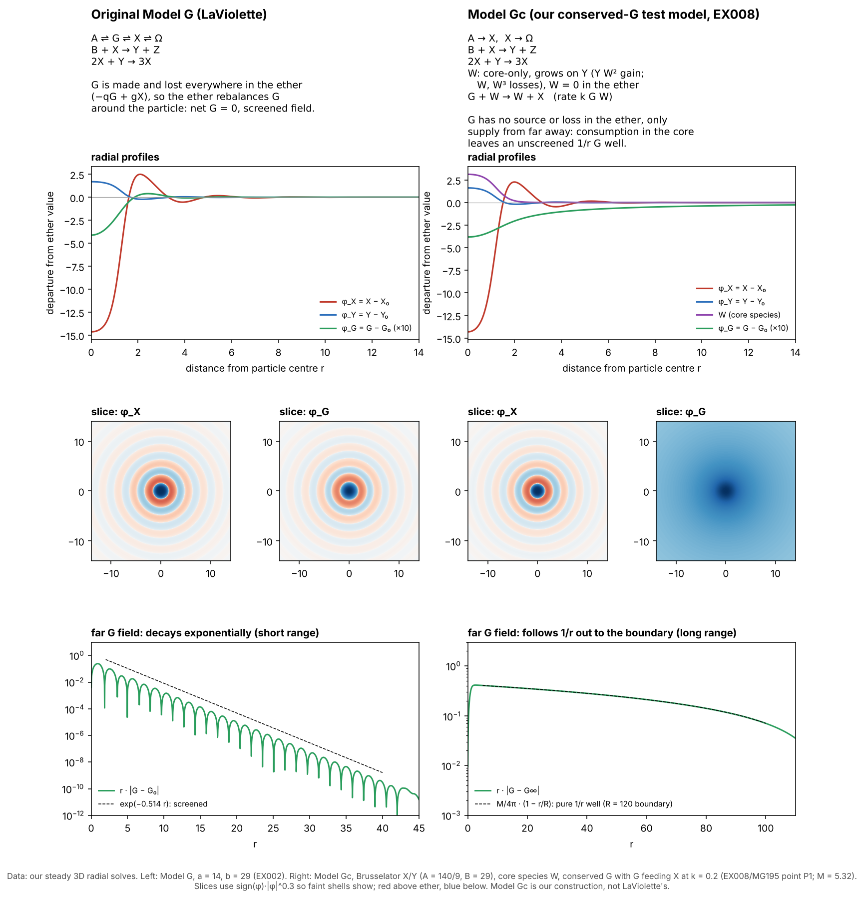

**Figure 1.** Model G versus Model Gc particles (steady 3D radial solves, EX002 and EX008). Left: in Model G the far G
field oscillates and decays exponentially (screened). Right: in Model Gc the far field follows S/(4π D_G r) out to the
boundary.

---

## 2. Model Gc

Definition: `spec/MODEL_Gc.md`. Gc1 (gravity only):

```
X_t = D_X ∇²X + A − (1+B)X + X²Y + c_x k G W
Y_t = D_Y ∇²Y + B X − X²Y + c_y k G W
W_t = D_W ∇²W − W + c Y W² − W³
G_t = D_G ∇²G − k G W
```

X and Y form a Brusselator ether (A = 140/9, B = 29, D_Y = 12). W is a core species that is zero in the ether
(c·Y₀ = 1.86 < 2) and is sustained inside a particle. G is conserved in the bulk, held at G∞ = 1 far away, and consumed
only where W is present; consumed G feeds X or Y. Outside the core, D_G ∇²G = 0, so

  G(r) = G∞ − S / (4π D_G r),  with S = ∫kGW dV.

All Gc1 studies used D_G = 1 unless stated; the wave-medium studies (EX-GC20 to 24) used other effective diffusion
constants. Gc2 adds a conserved signed carrier C and two core types that make or consume it, as a charge analogue
(EX010).

---

## 3. Gravitational sourcing and the inverse-square drift law

| Study | Result | Record |
|---|---|---|
| EX008 | Stable 3D particle. Far field G∞ − S/(4πr) to 1e-6, independent of domain size. Linear response: the particle drifts toward lower G. | `results/EX008_longrange/` |
| EX009 | Direct axisymmetric pair solve: approach speed 0.984–0.986 of the 1/d² prediction at d = 20–30. Short-range Turing repulsion near d ≈ 8. Interaction ∝ k², 1/r range down to k = 0.001. | `results/EX009_followups/` |
| EX010 | Gc2: tuned mirror charges repel/attract as like/unlike. With G added, every type drifts toward lower G; mobilities within 1–2%. Reciprocity is tuned at one point, not built in. | `results/EX010_charge_gravity/` |
| **MG195** (confirmatory, PI closed) | Registered in advance. **P1, P2 SUPPORTED** (v/prediction 0.98–0.99, fitted exponent 1.98). **C2** (Yukawa control) **PASS**. **P3 UNRESOLVED**: at weak coupling (k = 0.05) the registered null floor, set by a short-range Turing tail in the k = 0 null control, exceeded every P3 predicted signal. | `results/MG195_inverse_square/` |
| [EX-GC09](https://github.com/RichardBenear/Model-Gc/tree/main/results/EX-GC09) | On a 3D lattice (h = 0.5), as whole tokens, the far G deficit matches the lattice point-sink field within 1–4%. Survives at Ω = 1000 (S −6%) and 300 (−20%) over T = 30, fades at 100, dies at 30: about 10⁴ core tokens needed. | `results/EX-GC09/` |

**What this establishes and what it does not.** Gc particles are overdamped: they move at a velocity proportional to
the local G gradient. MG195 therefore establishes v ∝ 1/d², the spatial law of the interaction. It does not establish
a ∝ 1/d², which would need particles with inertia (Section 6).

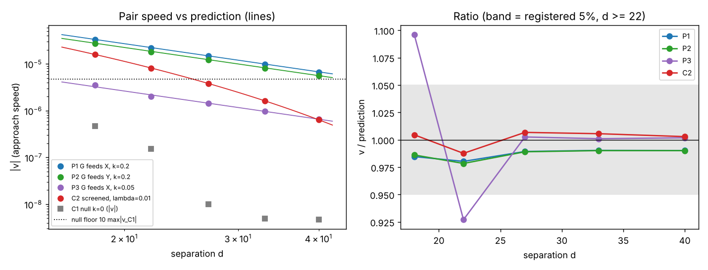

**Figure 2.** MG195: pair approach speed against the 1/d² prediction (left) and the ratio (right; band = registered
5%, scored at d ≥ 22). P1 and P2 lie at 0.98–0.99. P3 (k = 0.05) lies below the registered null floor (dotted line, left)
at every separation, so it is the registered UNRESOLVED case; it also leaves the band at d = 18–22. C2 is the screened (Yukawa) control.

*(Interpretation.)* Model Gc's gravity is a sink-flow (Le Sage-like) mechanism: the field is a steady inflow of a
conserved carrier toward consumers. This is what gives true 1/r range, and, as Section 6 shows, also what causes the
inertia problem.

---

## 4. The equivalence principle

### 4.1 In Gc1, free fall depends on particle type and binding

| Study | Result | Record |
|---|---|---|
| [EX-GC01](https://github.com/RichardBenear/Model-Gc/tree/main/results/EX-GC01) | v_i = μ_i S_j/(4πd²) within 1–2%. S_a v_a = S_b v_b only when mobilities match; a particle with doubled k falls 1.8× faster. | `results/EX-GC01/` |
| [EX-GC02](https://github.com/RichardBenear/Model-Gc/tree/main/results/EX-GC02) | *Demonstrated:* an effective inertial response from internal core dynamics. A slow core species makes the drag fall linearly with its response time, and a direct time response confirms an effective mass. It needs tuning near a type-dependent threshold (17.5–40), so free fall is not universal. | `results/EX-GC02/` |
| [EX-GC03](https://github.com/RichardBenear/Model-Gc/tree/main/results/EX-GC03) | Active and passive gravitational coupling agree within 5%, but drag is set by the shared X/Y core, so drift speeds spread 35%. Tuning a slow G brings this to 4–5%, only by tuning. | `results/EX-GC03/` |
| [EX-GC04](https://github.com/RichardBenear/Model-Gc/tree/main/results/EX-GC04) | Identical particles bind at d = 7.145 (and 10.11); the bound pair drifts at 0.939 (0.972) of a single particle's speed because consumption depends on local G (dS/dG = 4.58). | `results/EX-GC04/` |

### 4.2 The recoil rule: a universal response per unit of imposed inertia

EX-GC16 replaced G-dependent consumption with fixed-rate absorbers that are pushed along the arrival direction of the
tokens they absorb (token lattice, Ω = 1000 tokens per site). The particles were held stationary while the recoil
force was measured, and inertia proportional to the number of absorbing units was *imposed*.
- **Weak regime.** Five particle types had a recoil response of m₀E/3 per unit of imposed inertia (m₀ = 50, local
  depletion about 1%). Four agreed within 0.3–0.4%. The double-rate type was 1.8% high, within its statistical
  uncertainty (±5.7%, 1 SEM). The EX-GC16 note's summary "within 0.2–0.5%" overstated this for that type.
- **Pairs.** Two absorbers felt equal and opposite forces. These matched the lattice mean-field prediction within 1–3%
  at d = 2–4 and 9–11% (1σ) at d = 6–8; the prediction tends to m₀²/(12πΩd²). The source strength and the response
  strength are the same number, m₀.
- **Strong regime.** At m₀ = 500 (13% depletion) the response was 2–7% above m₀E/3, ordered by how concentrated the
  consumption is, as the mean field predicts. This is a self-energy (Nordtvedt-type) violation that scales as m₀/Ω.

This is a universal recoil response, not yet an independently derived equivalence principle, because the inertia was
imposed. Record: `results/EX-GC16/`.

---

## 5. Topological origins of spin-like behaviour and exchange statistics

### 5.1 Route 1, a rotating particle: did not work
No non-round core mode of Gc1 oscillates (EX-GC05). A slow core inhibitor ("Gc3") gives a breathing clock, not
rotation (EX-GC06), and in 3D time runs the breathing grows until the core collapses (EX-GC07). Each fix adds another
tuned ingredient.

### 5.2 Route 3, structure in the lattice
- **Belt trick (EX-GC08).** Each node carries one of the 24 rotations of a cube plus an SU(2) "lift" (48 elements).
  A local three-node no-cut rule (short lifts must compose around every triangle) gives a conserved Z₂ index: one turn
  stays tangled, two turns untangle. Pairwise rules leak or freeze.
- **Tokens and tether (EX-GC09, EX-GC10).** With the particle tethered by its own G supply, a one-turn twist collects
  next to the core and lowers S by 7.9%; two turns untangle (S within 0.6%). The twist is imposed by hand and the
  coupling strength is chosen.
- **No exchange sign from a tether (EX-GC11).** The frame-field tether has no identity (paths through it can be redrawn
  around a core), so swapping particles changes nothing. A field version of spin–statistics needs the particle itself to
  be a topological soliton.

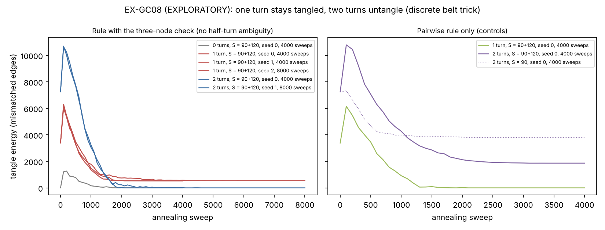

**Figure 3a.** EX-GC08: discrete belt trick. With the three-node rule, a one-turn twist stays tangled and two turns
anneal to zero (left); pairwise rules fail (right).

### 5.3 The particle as a knot
- **A stable lattice knot (EX-GC12).** A degree-1 texture (a "hedgehog" rounded to the 48 lifts) relaxes under the
  three-node rule to a compact knot of about 150 mismatched edges. Its degree stays exactly 1. Under a pairwise rule it
  unwinds. Two same-sign knots keep degree 2.
- **Exchange signature (EX-GC13).** Each loop of configurations was classified by its topological class (Figure 3b).
  A 360° turn and a swap of two knots are both non-contractible; a 720° turn, swap plus 360°, and a degree-2 knot turned
  by 360° are contractible. All 24 computations agree with Finkelstein & Rubinstein (1968), and each loop can be carried
  out on the lattice by allowed moves.
- **The knot as a Gc particle (EX-GC14, EX-GC15).** W autocatalysis is gated by the smoothed knot density, and the knot
  is pulled toward W (energy −λΣWρ); both couplings are *imposed*. The knot carries a stable Gc particle that sources the
  1/r field (within 0.1% of a lattice point sink); without a knot the particle dies. At h = 0.25 the knot particle
  drifts at −4.998×10⁻⁴, identical to a plain Gc particle to four digits and within 2% of the continuum value. Without
  the pull (λ = 0) the knot shrinks and the particle dies.

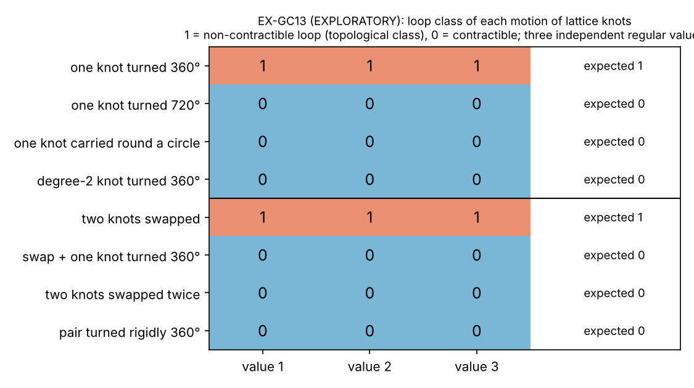

**Figure 3b.** EX-GC13: topological class of each loop, for three independent regular values (1 = non-contractible,
0 = contractible). The swap of two knots falls in the same class as a 360° turn of one knot. Made by
`src/whitepaper_figures.py` from the EX-GC13 records.

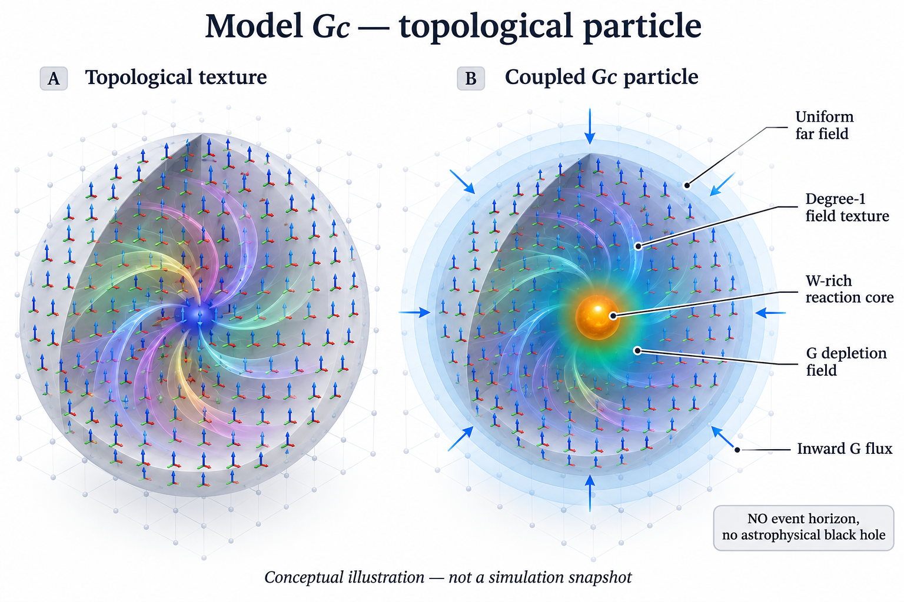

**Figure 4.** Conceptual illustration (not simulation data) of the topological particle. (A) The degree-1 frame
texture. (B) The coupled Gc particle: a W-rich reaction core inside the texture, consuming G, with the G depletion field
and the inward G flux around it. In EX-GC14/15 the knot gates the core's autocatalysis and is pulled toward the
core.

**How the knot rule works.** Moves are proposed at random and accepted by a Metropolis test on a mismatch count
(neighbour pairs holding different rotations) at temperature 0.6, in checkerboard order. The starting knot is built by
hand. The rule is local and stochastic, not a deterministic rewriting rule, and has not been tested for causal
invariance (`src/exgc12_soliton.py`, `src/exgc14_knotgc.py`).

### 5.4 What is and is not shown

| Property | Demonstrated? |
|---|---|
| Degree-one topological structure | Yes |
| Conserved topological degree | Yes, under the tested rules |
| Non-contractible 360° rotation loop | Yes |
| Contractible 720° rotation loop | Yes |
| Topological exchange signature (swap in the same class as a 360° turn) | Yes |
| Intrinsic angular momentum ħ/2 | No |
| Quantum exchange phase of −1 | No |
| Physical fermionic statistics | No |

The correspondence with Finkelstein–Rubinstein topology is substantial, but no quantum particle has been constructed.
Turning the classical loop class into a phase would need a quantum version of the rule.

---

## 6. The inertia investigation

### 6.1 Absorption gives drag, not inertia (EX-GC17)
A particle moving through the token gas meets more tokens from ahead. Per unit of imposed inertia the resulting drag is
γ ≈ m₀/6 (within 1–2% at m₀ = 50). Because drag and the gravitational push both come from absorption, the terminal
drift speed is universal (within ±2% of 2E, even where the push alone differs by 7%). The response to acceleration has
the wrong sign for inertia (κ/γ ≈ 0.01–0.07, anti-inertial). So the medium gives Aristotelian, not Newtonian, motion.
*(Interpretation.)* This is the classic objection to Le Sage-type gravity, found here in a concrete model.

### 6.2 Moving the particle as one body
- **EX-GC18 (failed).** Applying the recoil to the knot tears it off the core; pushing W locally squeezes the core. A
  reaction–diffusion pattern has no variable that carries momentum.
- **EX-GC19.** A flow field V, carried by the pattern, lets the particle accelerate as one body; K = 0.2 and 0.4
  particles accelerate within 4%. Cohesion is needed or the core is crushed. The knot cannot keep up.
- **EX-GC20/21.** G as a wave (telegraph equation); a knot carried with the flow stays within one lattice step.
- **EX-GC22 (ChatGPT).** Most of the coasting loss in EX-GC19/20 was a defect of the flow model: the transport term
  (V·∇)V was missing. Our earlier "accretion drag" interpretation was withdrawn and errata were added.
- **EX-GC23 (ChatGPT).** With (V·∇)V the particle coasts. The strong particle keeps 97.06% of its internal speed over
  20 units (73.91% without the term), and its core travels 0.963 of the ideal distance; a weak particle keeps 99.81%.
  A 2.5% slip remains. The inertia is *imposed* (τ = 20), and the head-on absorption drag of Section 6.1 was switched
  off.

### 6.3 The medium's own inertia under the assumed absorption-drag law (EX-GC24A, ChatGPT)
For a prescribed source moving through the wave medium, the reactive (added) mass is positive when damping is weak and
negative when it is strong, consistent with the anti-inertia of EX-GC17. Two values should be kept apart. The analytic
lossless mass in an infinite domain is S²/(6π^{3/2}c²σ) = 0.265 at the reference settings. The reactive coefficient
measured in the finite box (L = 32, τJ = 20, ω = 0.003) is 0.231, and 0.2312 with the actual 1/G weighting; the
coasting times below use the latter. Combined with the head-on drag b = S inherited from EX-GC17, the
characteristic coasting time m/b_total is 0.0433 time units for the reference particle (S = 5.32) and 0.00217 for a
weak one (S = 0.266). The EX-GC23 runs lasted 20 units, and with imposed inertia the particle kept 97% of its speed over
that time. The added mass also scales as S² while gravitational sourcing scales as S, so it could not be a universal
mass.

This is a **conditional negative**: it holds under the assumed absorption-drag law and for a prescribed source. It does
not rule out every possible form of field-generated inertia. Records: `results/EX-GC24/`,
`review/EX-GC24A_claude_review.md`.

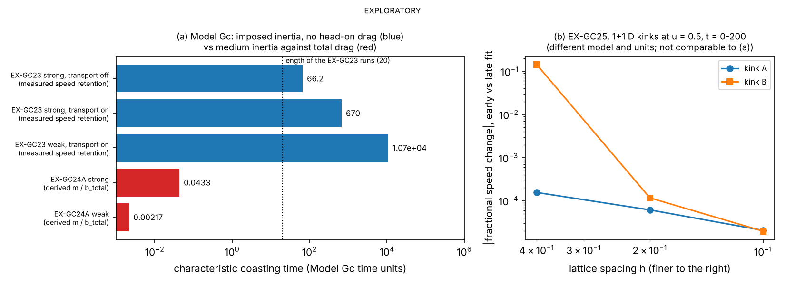

**Figure 5.** (a) Characteristic coasting times in Model Gc, from two different measures. Blue: EX-GC23, inferred from
measured speed retention with imposed inertia and no head-on drag (time = −20/ln(speed retained over 20 units)).
Red: EX-GC24A, derived from the reactive-mass-to-total-drag ratio m/b_total. (b) EX-GC25: measured fractional speed
change of 1+1 D kinks against lattice spacing. Panel (b) is a different model in different units and is shown only to
show the trend with resolution, not as a coasting time comparable with (a). Made by `src/whitepaper_figures.py` from
the committed records.

---

## 7. The rest-frame obstruction and a frame-free alternative (EX-GC25)

### 7.1 Why consumption-based gravity needs a rest frame
A conserved carrier has a density and a flux that form one four-vector. A uniform background density is that vector
pointing purely in time, which is true in one frame only. A particle moving through it at speed u meets a flux G∞u,
and absorbing that flux costs momentum. This is the drag of Section 6.1. Within the net-absorption mechanism studied here
(a conserved carrier drawn from a uniform background), no choice of medium dynamics removes it. *(Interpretation.)*
In that mechanism, gravity from net absorption and Newtonian inertia without a preferred frame are incompatible. Other
mechanisms are not excluded by this argument.

### 7.2 A frame-free design principle
- A constant scalar field value is the same in every frame. If G is a scalar field with vacuum value G∞ and a lossless
  wave equation, a particle disturbs it, and the static disturbance obeys Laplace's equation, so a 1/r field is
  possible. Like sources of a scalar field attract.
- A particle in uniform motion would carry a Lorentz-contracted copy of its field, with nothing to drag on.
- If G couples to the particle's energy (the trace of its energy–momentum tensor, Nordström 1913), von Laue's theorem
  makes the gravitational source strength of any stable, localized, static object equal its rest energy, which is its inertial
  mass. This would hold for every particle type and for bound composites including their binding energy, and would
  answer Section 4.1.

Universal energy coupling is a **design principle** here, not an emergent result: it is chosen, and the theorem then
guarantees universality.

### 7.3 What EX-GC25 demonstrated (1+1 D)
Relativistic φ⁴ kinks stood in for particles; they are not Gc particles.
- **External potential, energy coupling.** Four kinks with rest energies 8× apart fell at 0.9987–0.9995 of the predicted
  universal rate.
- **External potential, other coupling.** With a source strength not tied to energy, fall rates spread by a factor of 16,
  matching Q/M within 0.8%.
- **Coasting.** Launched at half the wave speed with no potential, kinks lost 2×10⁻⁵ to 2×10⁻⁴ of their speed over 200
  time units, shrinking with lattice spacing. A kink only 1.8 lattice spacings wide lost 14%: the lattice itself is a
  rest frame.

It did **not** demonstrate a particle generating its own gravitational field, carrying that field while moving, or
interacting gravitationally with another particle; EX-GC26 (Section 8) tests those in 3D. Record: `results/EX-GC25/`, figure
`paper/figures/exgc25_framefree.png`.

### 7.4 What the change would cost
- **G is no longer conserved or consumed.** The 1/r field becomes a static disturbance, not a flow. This is a new
  model, not a repair of Model Gc.
- **No persistent drag from a background rest frame.** The requirement is that uniform motion feels no persistent
  drag from a background frame. A closed conservative system may still radiate energy while conserving total energy and
  momentum. Friction against a fixed background or a heat bath does define a rest frame, so neither the dissipative
  reaction–diffusion core nor the present Metropolis knot rule qualifies as it stands. The knot is the natural particle, but it
  needs a reversible, momentum-conserving rule (and in 3D a Skyrme-type term for stability; Derrick 1964, Skyrme 1961).
  EX-GC26 uses a continuous field on a lattice for this, not a token rule.
- **Scalar gravity is incomplete.** Nordström's theory gives Newton's law and the equivalence principle, but it
  predicts no light bending and a perihelion shift of the wrong sign. A full theory needs a tensor part.
- **Discreteness is a rest frame.** Drag returns for particles near the lattice size. That causal invariance restores frame
  independence at large scales in Wolfram-style models is a research hypothesis. It has not been shown to guarantee
  Lorentz invariance in our models, and it is untested here.

---

## 8. A self-gravitating, frame-free topological particle (EX-GC26)

EX-GC26 tested steps 1–7 of the v0.3 research direction in one reference model. **This is not Model Gc.** It drops the
consumed carrier altogether. The particle is a Skyrmion (Skyrme 1961), a degree-1 knot of a unit four-vector field
φ ∈ S³, with energy E = E₂ + E₄ from a quadratic (sigma-model) term and a quartic (Skyrme) term. Gravity is a
Nordström scalar Φ that enters the action through the metric e^{2Φ}η. Because the quartic term is conformally
invariant, only the quadratic term is weighted, by W = e^{2Φ}. The field has its own lossless wave action, so knot and
field form one conservative system:

```
L = L_Skyrme[φ; W = e^{2Φ}] + Σ h³ (Φ̇² − |∇Φ|²) / (8π G_N)
Φ̈ = ∇²Φ − 4π G_N ρ,   ρ = 2W(e₂ − k₂)/12π²   (e₂, k₂: gradient and kinetic densities of the quadratic term)
```

The energy coupling is *imposed* (Section 7.2). What the runs test is whether a lattice particle actually realises its
consequences. All runs use c = 1, energies in units of 12π², a cubic lattice of spacing h = 0.2 (some at 0.15), RK4
with projection onto S³, and fixed-vacuum box walls. Plans and pass criteria were logged before each run. Studies 26A2,
26B, 26B2 and 26B3 were designed and run by ChatGPT with Claude's review. The others were run by Claude; 26E2, 26D and
26F ran on the PI's PC.

### 8.1 The particle (26A, 26A2)

- **Stable and lossless.** The lattice Skyrmion holds its degree (the geometric degree is exactly −1; 26A2). Its total
  energy is conserved to 3e-10 while it is shaken. After a kick it settles back to its rest energy (to 2e-7). A start
  with no knot dissolves.
- **Rest energy.** E = 1.202 (h = 0.2) and 1.217 (h = 0.15), extrapolating to within 0.75% of the radial value 1.231
  (the topological bound is 1).
- **The lattice breaks scale balance.** E₂/E₄ = 0.88 (h = 0.2) and 0.93 (h = 0.15) instead of 1 (Derrick 1964). This
  matters below: on the lattice the knot's gravitational charge is 2E₂/E instead of 1.
- **26A fully met 4 of its 8 registered criteria and one partly.** The shortfalls (fractional finite-difference degree, Derrick
  balance, an unconverged lopsided start) were traced to lattice and measurement effects (26A2). 26A also used
  2.4 core-hours, over the 2-hour cap (logged).

### 8.2 Inertia equals rest energy (26B, 26B2, 26B3; ChatGPT)

- **Lorentz-boosted knots carry the right energy and momentum.** H/(γE₀) is within 0.02–0.8% of 1 for u = 0.1–0.5.
- **The energy moves slightly slower than P/H.** Along a lattice axis the centroid speed is 0.982–0.993 of P/H. 26B2
  traced this to the lattice: the exact discrete energy current J differs from the momentum P at order h². A
  mirror-symmetric eight-orientation stencil removed the spurious transverse momentum (by a factor of about 2 million)
  but not this gap.
- **Inertial mass, measured independently by applying a force (26B3):**

  | | h = 0.2 | h = 0.15 |
  |---|---:|---:|
  | momentum ÷ (γ v E₀) | 1.001 | 0.997 |
  | force ÷ (acceleration E₀) | 1.042 | 1.018 |
  | momentum gained ÷ impulse | 0.965 | 0.982 |

  The direct mass equals E₀ to 0.3%. The force-response systematic of 2–4% shrinks with h roughly as h². This meets the
  v0.3 requirement that M_i be measured independently of E₀ (Section 10 of v0.3).

### 8.3 The equivalence principle and binding energy (26E1, 26E2)

**Setup.** A bound B = 2 torus and a single B = 1 knot fall in the same ramped uniform field, Φ = g·x with g = 0.0125.
The ratio of their fall rates is the readout.

- **Lattice predictions.** Each falls at a/g = −2E₂/E. That is a 1.3% (h = 0.2) and 0.6% (h = 0.15) difference
  between them, against 1 in the continuum. If binding energy did not gravitate, the ratio would be 2E₁/E₂ = 1.041–1.043.
- **A non-energy control.** A coupling not tied to energy, run in the same setup, predicts a ratio of 1.39–1.43.

| | h = 0.2 | h = 0.15 |
|---|---:|---:|
| Ratio B2/B1, energy coupling (four readouts) | 0.995–1.020 | **0.988–1.009** |
| Lattice prediction | 1.013 | 1.006 |
| No-binding alternative | 1.041 | 1.043 |
| Control coupling, measured (predicted) | 1.35–1.45 (1.425) | 1.32–1.41 (1.39) |

On the finer grid every readout is 3.4–5.5% below the no-binding value. *Demonstrated (exploratory, two resolutions):*
the bound pair, binding energy included, falls with the single knot. The method does detect a built-in violation: the
control coupling gives one. The binding energy is only 4% of the pair's mass, so this is a weak-field, few-percent test.

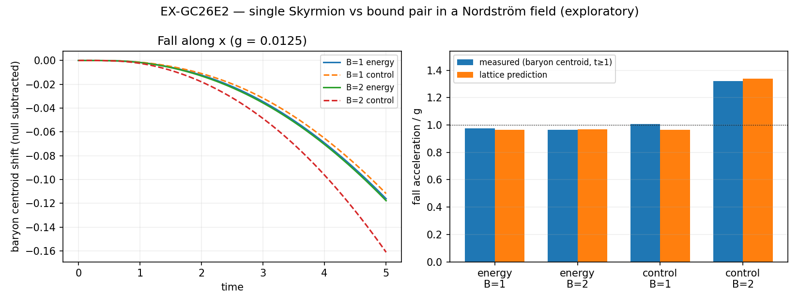

**Figure 6.** EX-GC26E2 (h = 0.15): fall of the single knot and the bound pair under the energy coupling and the control
coupling.

### 8.4 The knot sources its own field (26C)

**Setup.** The knot starts with Φ = 0 and is evolved with the dynamical field (G_N = 0.01 and 0.02, box ±17, T = 12).

- **The field forms causally and is 1/r.** It grows as a front moving at c. Behind the front r·Φ is constant to 2%
  from r = 3 to 10.
- **Its strength equals the knot's own source.** A/G_N is 0.995 of the integrated ρ. As G_N → 0 it tends to 2E₂,
  the lattice rest energy, to within 0.4%.
- **Active mass of the bound pair.** B2 ÷ B1 is 1.936. The lattice prediction is 1.947, the energy ratio 1.922, and
  no binding would give 2. So binding energy is a weaker source, as 26E found it is a weaker falling mass.
- **Stable.** Total energy (knot plus field) is conserved to 3e-12. The knot keeps its degree and does not move.

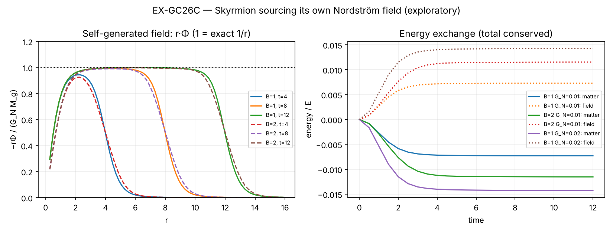

**Figure 7.** EX-GC26C: r·Φ normalised to the knot's source (1 = exact 1/r), and the energy exchange between knot and
field.

### 8.5 Coasting with its own field: no drag (26D)

**Setup.** The settled 26C knot and its field were Lorentz-boosted together to u = 0.1 and 0.3 and run to T = 8. Each
run is compared with a no-field control.

- **No drag.** The coupled knot's speed changed exactly as the control's did. The difference was −7e-5 and +5e-6 over
  8 time units; the consumption models of Section 6 lost their speed in about 0.04.
- **The field moves with the knot, contracted along the motion.** From a clean field-only check:
  - fore/aft ratio 1.000–1.013;
  - axial/side ratio 0.949–0.957 at u = 0.3, where 1/γ = 0.954.
- **A setup flaw.** In the PC runs themselves a far-field taper in the setup spoiled the co-motion readout beyond
  distance 3. This is recorded as a plan flaw.
- **Energy** conserved to 5e-10.

The rest-frame obstruction of Section 7.1 is absent, as the design intended.

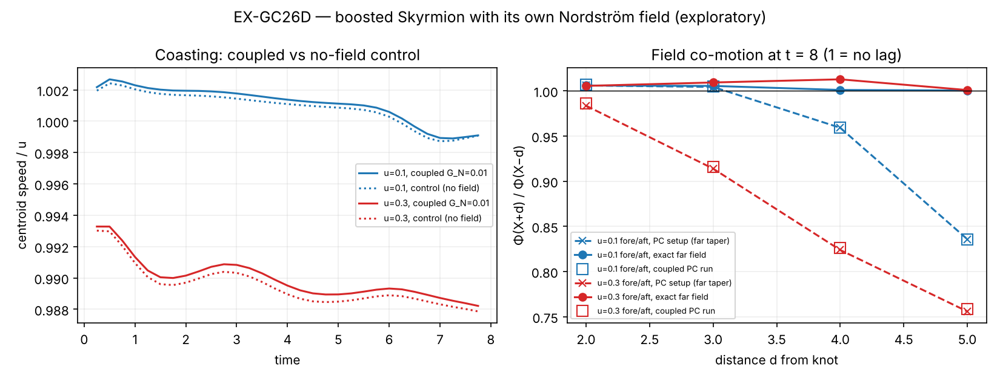

**Figure 8.** EX-GC26D: centroid speed of the coupled knot and its no-field control (left), and the fore/aft field ratio
for the PC setup and for the exact far field (right).

### 8.6 Two knots attract (26F)

**Setup.** Two B = 1 knots, each with its own field, start at rest at d = 6 and 9.2 (G_N = 0.01, T = 10). The knots also
repel each other directly through their Skyrme tails, at about 1.5–2 times gravity even in the least-repulsive
orientation. Each run therefore has a G_N = 0 control with the identical start, and the gravitational signal is the
separation difference.

**Prediction.** Newtonian: a_rel = −2(2E₂/E)A/d², using 26C's A and 26E's passive charge.

| d | baryon centroid ÷ prediction | energy centroid ÷ prediction |
|---:|---:|---:|
| 6 | 0.90 | 0.84–0.96 |
| 9.2 | 0.95–0.96 | 0.89–0.92 |

- **The pull is inverse-square.** The ratio of pulls at the two distances is 2.20–2.38. The prediction is 2.35; a 1/d
  force would give 1.53.
- **Registered verdict: supported, narrowly.** The window was 0.90–1.10.
- **The pull is systematically weak.** The likely cause, untested, is that gravity changes the direct Skyrme force,
  which the control cannot remove. That force is larger at d = 6, where the deficit is also larger.
- **Energy** conserved to 2e-10; momentum to 1e-8 of E.

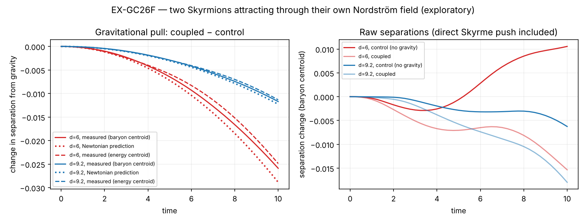

**Figure 9.** EX-GC26F: gravitational change in separation (coupled minus control) against the Newtonian prediction
(left), and the raw separations including the direct Skyrme push (right).

### 8.7 What EX-GC26 does and does not show

| Property | Status |
|---|---|
| Stable, lossless topological particle (3D) | Demonstrated (lattice, h = 0.15–0.25) |
| Inertial mass measured independently and equal to rest energy | Demonstrated (0.3% direct; 2–4% force response, shrinking with h) |
| Universal free fall including binding energy | Demonstrated at the few-percent level (two resolutions) |
| Self-generated 1/r field with active mass = energy source | Demonstrated |
| Drag-free coasting with a co-moving, contracted field | Demonstrated |
| Mutual attraction ~1/d² at Newtonian strength | Demonstrated at 0.90–0.96 (one resolution, two separations) |
| Energy coupling derived rather than chosen | No: imposed |
| Light bending, perihelion shift | No: scalar gravity fails these (light bending is obtained at linear order in Section 10) |
| Orbits, strong fields, radiation reaction | Not tested |
| A discrete, causally invariant rule version | Not attempted: continuous fields on a fixed lattice |
| Quantum spin or statistics | No |

*(Interpretation.)* The three lines of this programme (gravity, topology, inertia) do coexist in one conservative,
relativistic field configuration. That was the decisive question posed in v0.3. But the coexistence is guaranteed by the
chosen relativistic action and the von Laue theorem. The runs show that a lattice realisation inherits it to a few
percent. They do not discover gravity: the coupling to energy is put in. Relative to Model Gc, the price is the one
stated in Section 7.4. G is no longer a conserved, consumed carrier. Gravity becomes a field disturbance, not a flow.

Records: `results/EX-GC26A` to `results/EX-GC26F`, each with its note, code (`src/exgc26*.py`), figure and compute
record. The three PC studies (26E2, 26D, 26F) used 12.6 core-hours of the PI's 40 core-hour allowance.

---

## 9. Intermediate explorations: where could a common coupling come from? (EX-GC27–33)

EX-GC26 worked because one action multiplied every matter term by the same factor. That coupling was *imposed*. The
next series asked whether something deeper could supply it. Most of these studies were designed and run by ChatGPT,
with Claude reviewing and reproducing them, and all are closed by the PI. None uses Model G or Gc dynamics. They are
summarised briefly here; each has its own note and review.

- **Vacuum (zero-point) responses (27A/B, 28A–H, 29A).** Independent scale or vacuum terms remove the universality
  guarantee. A non-metric coupling weighs zero-point energy differently from classical energy (0.84 against 0.92 per
  unit). The Casimir interaction of two defects falls as 1/d³, not Newtonian. Loop-induced scalars give
  species-dependent sources unless tuned. Sakharov's induced Einstein–Hilbert term appears with textbook coefficients
  set by the cutoff. With minimal metric coupling the whole dressed particle gravitates (ADM mass), but any extra
  massless scalar is a non-universal fifth force. Reviews: `review/EX-GC27AB_28A_claude_review.md`,
  `review/EX-GC28B-G_claude_review.md`, `review/EX-GC28H_29A_claude_review.md`.
- **Emergent common geometry (30A–B3).** Condensate and Weyl-winding routes either need tuning that fails under
  density or give different metrics to different sectors. Review: `review/EX-GC30A-B3_claude_review.md`.
- **Causal rules and relational vacua (31A–33A).** Exact counterexamples show that a schedule-invariant (causally
  invariant) rule can still carry two different signal speeds, so causal invariance is necessary for the programme's
  goal but does not by itself give one light cone (31A). Archived rewriting rules from a related project showed no two-event causal
  diamonds (31B1), and five hand-built causally invariant rules each had a structural defect (31B1B–F). Positive zero-point link energy favours deleting links, not forming lattices (32C). The
  most useful outcome was 33A: any mechanism in which energy sources the geometry must make the clock part respond to
  total energy, S = κ(H − E₀). Review: `review/EX-GC31A-33A_claude_review.md`. The proposed GC33B (IKKT matrix model)
  was not pursued (PI decision, 2026-11-22).

*(Interpretation.)* The series did not find a free origin for the coupling, but it sharpened the question. One
structure must build every field's kinetic term (the matrix-model lesson of GC33A), and its clock part must be sourced
by total energy. EX-GC34 tests exactly that, inside our own lattice framework.

---

## 10. One shared lattice structure for every field (EX-GC34)

**Idea.** Every field, matter or light, moves through the same lattice variables, and no field has its own speed
coefficient:
- a **lapse** N per site: the local clock rate, playing the role SQK gives the G concentration;
- **link weights** on the 3 axis and 6 face-diagonal links, whose second moment encodes the full spatial metric
  (A = N√γ γ⁻¹);
- from 34E, a **shift** β per site: how fast the lattice points move relative to the clock-normal observers.

A field's static energy is multiplied by N and its kinetic energy divided by N. That is the "clock rule". Plan:
`docs/EX-GC34_outline.md`. Claude designed and ran all five stages; ChatGPT recomputation is pending. Each stage had a
plan and an `explore/LOG.md` entry pushed before its runs.

### 10.1 One light cone, and textbook bending on prescribed fields (34A, 34A-r)

- **One cone.** Massless, massive, two-component and non-linear sigma-model fields all move at the shared-structure
  prediction, within 0.19% (linear) and 0.32% (sigma model), on flat and anisotropic backgrounds (M1, 54/54). A
  control field with its own link weights is caught at +4.7% to +4.9%.
- **Bending.** In a prescribed weak field, a massless packet bends 2.004 × as much in a GR-like (γ = 1) background as
  in a lapse-only one. A conformally flat (Nordström) background bends it by 0.005 of that (Figure 10a).
- **Record:** 68 of 69 registered cases pass. The miss is the sigma model in the GR-like background, 5.3% against a
  5% tolerance. The first run (34A) failed its registered readout because packet tails wrapped around too small a
  periodic box. That was a plan flaw, and 34A-r reran the study with a wrap-immune circular centroid.
- **What it means.** This is by construction: it verifies the code and the readout. It does not show that matter
  produces such fields.

### 10.2 What sources each part (34B)

- **Clock (lapse) part.** For every field built on the structure, the lapse source is the energy density, exactly
  (≤ 1e-6 in all 7 cases). This includes the B = 2 knot's binding energy and moving packets. *Demonstrated:* the
  GC33A condition holds by construction.
- **Spatial part.** Its source is the stress tensor. For a knot at rest the stress integrates to the lattice Derrick
  offset only: 6.4% of E at h = 0.2 and 3.6% at h = 0.15, which is the h² scaling, so it goes to zero in the continuum
  (von Laue). Radiation and moving matter do source it.
- **Record:** 5 of 6 registered criteria pass. The massive-packet row failed because of a formula slip in my plan
  (v_g·v_p written for v_g/v_p); the data agree with the correct expectation to 0.75%.
- **Consequence.** The shared structure fixes universal coupling, but not light bending. If each part obeyed its own
  equation, a body at rest would produce only a lapse field (γ = 0, half of GR's bending).

### 10.3 What selects GR's light bending (34C, analytic)

Static, linear, in Fourier space (sympy), with a separate numerical deflection check:

| gravity action | γ |
|---|---:|
| lapse and spatial metric as independent fields | 0 |
| Nordström (conformally flat) | −1 |
| "pure clock" rule only (lapse multiplies gravity's own energy, as for matter) | free (depends on coefficients) |
| pure clock + linear gauge invariance | still free |
| **pure clock + one relabelling-invariant energy (√γR, static Fierz–Pauli = ADM)** | **1** |

*Demonstrated:* both rules are needed, and together they give exactly linearised GR's static equations with a
Newtonian lapse. The pure-clock rule is the matter rule of 10.2 applied to gravity itself. The covariance rule is the
open question for a lattice.

### 10.4 A lattice-native covariant energy: Regge calculus (34D)

- **Construction.** Each cube is split into 6 tetrahedra (7 edges per vertex). Gravity's energy is
  (1/κ) Σ_edges N_e l_e ε_e, with ε_e the deficit angle around edge e (Regge 1961), multiplied by the lapse as the
  clock rule requires.
- **Static field of a mass.** *Demonstrated:* the solution is exactly linearised GR's isotropic one at every lattice
  wavelength. Each edge shrinks by the mean lapse of its two ends, plus a relabelling of the lattice points, which fits
  to 1e-13 over the whole Brillouin zone (post hoc). The lapse is Newtonian with G = κ/8π, with a 0.02% lattice
  dispersion at kh = 0.05. Implementation checks pass, including a direct non-linear Regge sum (1e-5).
- **Light bending.** A straight-ray readout gives a ratio of exactly 2 for Gaussian and knot sources. That is an
  identity for rays along lattice edge directions.
- **Registered failure.** The packet test failed its registered window (2 ± 3%): the packet bent 2.056 × and the
  rays 2.062 × the lapse-only amount. On the same geometry written in isotropic coordinates (post hoc), they bent
  1.989 × and 2.000 ×. So the excess comes from the coordinates. The direction was measured 10–18 units from the mass,
  which is coordinate-dependent, and the plan should have used an asymptotic readout. Rays bent about 3% more than
  the packets in both backgrounds, the opposite sign to 34A-r. That cause is not traced.
- **Moving sources (analytic).** Without a shift, a moving mass's gravitomagnetic field has to be stored in the
  spatial metric with amplitude ∝ 1/(k·v), and it is lost for modes with k ⊥ v. So the structure needs a shift.

### 10.5 Adding the shift: linear GR on the lattice (34E)

- **Construction.** The shift β is the velocity of the lattice points relative to the clock-normal observers. Each
  tetrahedron's strain rate comes from its 6 edge-length rates minus what the vertex motion explains. The kinetic
  energy is the lattice DeWitt form (1/2κ) Σ V (K_ijK_ij − K²)/N, so the clock rule applies again. Lapse and shift
  enter as multipliers, which gives GR's two constraints.
- **Gravitomagnetism.** *Demonstrated:* the linearised Riemann tensor of a moving source matches linearised GR to
  4.2e-4 at kh = 0.05, shrinking as k². For motion perpendicular to the wavevector (34D's failing case) the momentum
  constraint holds to 1e-15.
- **Gravitational waves.** *Demonstrated (post hoc scan):* there are exactly two modes in every direction, moving
  within 1.4e-4 of the light speed that matter has on the same lattice at kh = 0.05. No other mode appears from
  1e-4 k up to the lattice cutoff. Off the lattice axes the two polarisations split by 2e-4 (∝ k²), which is lattice
  anisotropy (Figure 10b).
- **Registered failure.** The registered mode-count method failed (it found 0, 1 and 2 modes along 100, 110 and 111).
  It used a matrix pencil, and that pencil is singular wherever the lattice keeps the time-relabelling (re-slicing)
  symmetry exactly. That symmetry is exact for waves along the axes and broken at O((kh)²) elsewhere. The breaking
  produced no extra mode here, but it leaves one weakly fixed direction that a time-stepped or non-linear version
  must watch.

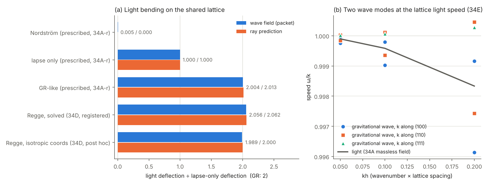

**Figure 10.** (a) Light deflection divided by the lapse-only deflection for a massless packet (blue) and the ray
prediction (orange) on the shared lattice: prescribed Nordström, lapse-only and GR-like fields (34A-r), and the
Regge-solved field of a mass as solved (34D, registered) and in isotropic coordinates (34D, post hoc). (b)
Gravitational-wave speeds on the lattice (34E, post hoc scan) for three directions, against the light speed of a
massless matter field on the same structure. Generated by `src/whitepaper_figures_v05.py` from committed records. The
34A-r cone figure is `figures/exgc34ar_cone.png`.

### 10.6 What EX-GC34 does and does not show

| Property | Status |
|---|---|
| One light cone for every field on the structure | Demonstrated, by construction (34A-r) |
| Clock part sourced by total energy, binding included | Demonstrated, by construction (34B) |
| γ = 1 light bending selected by two stated rules | Demonstrated analytically (34C) |
| Lattice gravity energy giving GR's static field | Demonstrated exactly at linear order (34D, Regge) |
| Gravitomagnetism and two light-speed wave modes | Demonstrated at linear order (34E) |
| The clock rule for gravity's own energy, and Regge's action | Imposed (motivated, not derived) |
| Non-linear gravity (perihelion, strong fields), time-stepped lattice | Not tested |
| Re-slicing symmetry off the lattice axes | Broken at O((kh)²); no extra mode at linear order |
| Link to Model Gc's consumed carrier or reaction–diffusion particles | None yet |
| A discrete, causally invariant rule | Not attempted |

*(Interpretation.)* Section 8 gave a particle that inherits relativistic behaviour from its action. Section 10 gives a
lattice geometry that every field shares, whose own dynamics is that of linear GR once two rules are accepted: the
same clock rule for gravity as for matter, and a relabelling-invariant gravity energy. The tensor part that Section 8
lacked is now present, at linear order. It is still a continuous field theory on a fixed lattice, and much of it is
known physics (ADM, Regge calculus) rediscovered inside our framework rather than new physics.

Records: `results/EX-GC34A`, `EX-GC34Ar`, `EX-GC34B`, `EX-GC34C`, `EX-GC34D`, `EX-GC34E`, each with its note, plan in
`spec/`, and code `src/exgc34*.py`. Cloud compute for the whole series was about 4.2 core-hours.

---

## 11. How the investigation evolved

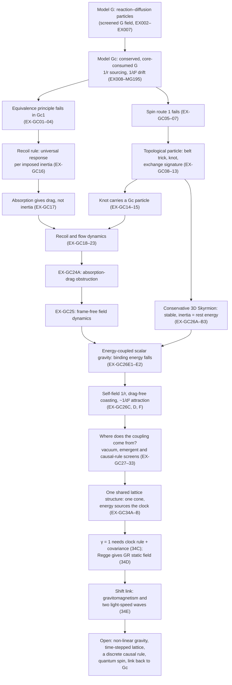

The gravity, topology and inertia lines developed separately and pointed to the same candidate: a conservative,
localized, relativistic field configuration with topological stability, rest energy equal to inertial mass, and
gravitational sourcing at once. EX-GC26 showed that such a configuration works in a reference model, with a scalar
coupling chosen rather than derived. EX-GC34 then replaced the scalar with a shared lattice geometry whose linear
dynamics is GR's.

---

## 12. What is and is not established

**Supported (registered or reproduced across independent checks):**
- A 1/r field and a 1/d² drift law from a conserved, core-consumed carrier (EX008, EX009, MG195 P1/P2, EX-GC09 on a
  lattice). MG195 P3 remains UNRESOLVED.

**Shown in exploratory work:**
- A universal recoil response per unit of imposed inertia in the weak regime, with a self-energy violation at strong
  consumption (EX-GC16).
- An effective inertial response from internal core dynamics, tuned and non-universal (EX-GC02).
- A stable lattice knot with exactly conserved degree, 360°/720° loop classes and the classical exchange signature
  (EX-GC12, 13).
- A knot carrying a Gc particle that sources the 1/r field and drifts at the right rate (EX-GC14, 15).
- Coasting of a particle with imposed inertia, once the transport term is included (EX-GC23).
- Absorption drag dominating medium-generated inertia, under the assumed drag law (EX-GC17, 24A).
- Universal fall of energy-coupled kinks in an external potential, and drag-free coasting, in 1+1 D (EX-GC25).
- In the Skyrme–Nordström reference model (EX-GC26, Section 8): a stable lossless 3D knot; inertial mass equal to rest
  energy (0.3% direct, 2–4% force response); universal fall of a bound pair and a single knot including binding energy
  (two resolutions); a self-generated 1/r field with active mass equal to the energy source; drag-free coasting with a
  co-moving, contracted field; mutual attraction ~1/d² at 0.90–0.96 of Newtonian strength.
- From one shared lattice structure (EX-GC34, Section 10), at linear order on a flat background: one light cone for
  every field; the clock part sourced by total energy including binding; γ = 1 light bending selected by the clock
  rule plus a relabelling-invariant gravity energy; GR's static field exactly from a Regge energy; GR's
  gravitomagnetism and two light-speed gravitational-wave modes once a shift link is added.

**Not shown:**
- Inertia or gravity that arises in Model Gc itself without being imposed. In the reference model, inertia follows
  from relativistic field dynamics and gravity from a chosen energy coupling.
- Non-linear gravity on the shared lattice: perihelion shift, strong fields, and orbits. Light bending is now
  obtained at linear order (Section 10), but only in the weak field.
- A time-stepped version of the shared lattice, and the fate of its weakly broken re-slicing symmetry.
- Any link between the shared lattice geometry and Model Gc's consumed carrier or its reaction–diffusion particles.
- Quantum spin, a quantum exchange phase, or fermionic statistics.
- Causal invariance of any rule used here; EX-GC26 is a continuous field on a fixed lattice, not a token rule.
- Lattice convergence of Model Gc's consumption S (it differs by about 10% between h = 0.5 and 0.4), and of the 26F
  attraction (one resolution).

---

## 13. Research direction (for the PI's decision)

The v0.4 direction listed "tensor gravity" first. EX-GC34 did that at linear order, within a single shared lattice
structure instead of a separate tensor field (Section 10). Open directions, in the order we would suggest:

1. **Recomputation and review of EX-GC34 (ChatGPT).** Five stages were designed and run by one author. They need the
   separate recomputation the GC34 outline foresaw, above all 34D (exact Regge solution) and 34E (wave modes).
2. **34F: a time-stepped lattice.** Step the linear 34E equations in time (leapfrog), check that a gravitational-wave
   packet travels stably at light speed, and see whether the weakly fixed re-slicing direction grows. This is the
   first place the inexact symmetry could matter.
3. **Non-linear gravity on the shared lattice.** Put the knot (Section 8) on the structure with full lapse × Regge +
   shift dynamics, and test a light ray passing a knot and, later, an orbit.
4. **A discrete, causally invariant rule.** The reference model now specifies what a rule must reproduce: a conserved
   knot degree, one set of shared link variables used by every field, and the clock rule. 31A showed that causal
   invariance alone does not give one cone, so the shared structure has to be built in.
5. **Back to Model Gc.** In SQK the G concentration sets local rates, which is the lapse's role here. Whether a
   conserved, consumed G could *be* the lapse (and what then plays the spatial metric) is the open link between this
   geometry and the original model.
6. **Quantum version** (unchanged from v0.4): collective-coordinate quantisation of the knot.

---

## Appendix A. Study index

| ID | Topic | Outcome in one line | Who |
|---|---|---|---|
| EX002–EX007 ([records](https://github.com/RichardBenear/Model-Gc/tree/main/docs/lineage)) | Model G gravity (parent repo) | Bulk reactions screen G (and net G is zero); only screened wells | Claude |
| EX008–EX010 ([records](https://github.com/RichardBenear/Model-Gc/tree/main/results)) | Model Gc design, pair interaction, charge | 1/r field, 1/d² drift, mirror charges | Claude |
| MG195 ([records](https://github.com/RichardBenear/Model-Gc/tree/main/results/MG195_inverse_square)) | Inverse-square (confirmatory) | P1, P2 supported; C2 pass; P3 unresolved | Claude, PI closed |
| [EX-GC01–04](https://github.com/RichardBenear/Model-Gc/tree/main/results/EX-GC01) | Equivalence principle in Gc1 | Non-universal across types and composites | Claude |
| [EX-GC05–07](https://github.com/RichardBenear/Model-Gc/tree/main/results/EX-GC05) | Rotation / clock | Failed | Claude |
| [EX-GC08–11](https://github.com/RichardBenear/Model-Gc/tree/main/results/EX-GC08) | Belt trick, tokens, tether, exchange | 720° works; tether gives no exchange sign | Claude |
| [EX-GC12–15](https://github.com/RichardBenear/Model-Gc/tree/main/results/EX-GC12) | Knot particle | Stable, conserved, exchange signature, carries a drifting Gc particle | Claude |
| [EX-GC16](https://github.com/RichardBenear/Model-Gc/tree/main/results/EX-GC16) | Recoil rule | Universal response per imposed inertia (weak), 1/d² | Claude |
| [EX-GC17](https://github.com/RichardBenear/Model-Gc/tree/main/results/EX-GC17) | Drag | Drag, not inertia; universal terminal speed | Claude |
| [EX-GC18–21](https://github.com/RichardBenear/Model-Gc/tree/main/results/EX-GC18) | Recoil on knot; flow field; wave G | Body motion works; coasting loss later traced to a defect | Claude |
| [EX-GC22–23](https://github.com/RichardBenear/Model-Gc/tree/main/results/EX-GC22) | Flow-model defect; transport term | Particle coasts with imposed inertia | ChatGPT (Claude review) |
| [EX-GC24A](https://github.com/RichardBenear/Model-Gc/tree/main/results/EX-GC24) | Medium-generated inertia | Coasting time 0.043/0.0022 under assumed drag; scales as S² | ChatGPT (Claude review) |
| [EX-GC25](https://github.com/RichardBenear/Model-Gc/tree/main/results/EX-GC25) | Frame-free medium | 1+1 D kinks: energy coupling universal in external potential; coasting | Claude |
| [EX-GC26A](https://github.com/RichardBenear/Model-Gc/tree/main/results/EX-GC26A), [26A2](https://github.com/RichardBenear/Model-Gc/tree/main/results/EX-GC26A2) | 3D Skyrmion on a lattice | Stable, lossless, exact degree; 4 of 8 registered criteria fully met, 1 partly (lattice shortfalls explained) | Claude; ChatGPT (A2) |
| [EX-GC26B](https://github.com/RichardBenear/Model-Gc/tree/main/results/EX-GC26B), [26B2](https://github.com/RichardBenear/Model-Gc/tree/main/results/EX-GC26B2), [26B3](https://github.com/RichardBenear/Model-Gc/tree/main/results/EX-GC26B3) | Inertial mass | Boosts Lorentz-correct to ~1–2%; M_i = E₀ to 0.3%; O(h²) energy-current gap | ChatGPT (Claude review) |
| [EX-GC26E1](https://github.com/RichardBenear/Model-Gc/tree/main/results/EX-GC26E1), [26E2](https://github.com/RichardBenear/Model-Gc/tree/main/results/EX-GC26E2) | Fall of single knot vs bound pair | Ratio 0.988–1.009 (h = 0.15); binding energy gravitates; control violation seen | Claude, PI closed |
| [EX-GC26C](https://github.com/RichardBenear/Model-Gc/tree/main/results/EX-GC26C) | Knot sources its own field | 1/r, active mass = source; B2/B1 1.936 | Claude, PI closed |
| [EX-GC26D](https://github.com/RichardBenear/Model-Gc/tree/main/results/EX-GC26D) | Coasting with own field | No drag (≤ 7e-5); field co-moves, contracted | Claude, PI closed |
| [EX-GC26F](https://github.com/RichardBenear/Model-Gc/tree/main/results/EX-GC26F) | Two-knot attraction | ~1/d², 0.90–0.96 of Newtonian; supported narrowly | Claude, PI closed |
| EX-GC27A/B, 28A–H, 29A ([records](https://github.com/RichardBenear/Model-Gc/tree/main/results)) | Vacuum responses, induced gravity | No free universal coupling; Sakharov term recovered; extra scalars non-universal | ChatGPT (Claude review), PI closed |
| [EX-GC30A–B3](https://github.com/RichardBenear/Model-Gc/tree/main/results/EX-GC30A) | Emergent common geometry | Tuning fails under density; sector metrics split | ChatGPT (Claude review), PI closed |
| [EX-GC31A–33A](https://github.com/RichardBenear/Model-Gc/tree/main/results/EX-GC31A) | Causal rules, relational vacua | Causal invariance does not give one cone; universal source needs lapse ∝ total energy | ChatGPT (Claude review), PI closed |
| [EX-GC34A](https://github.com/RichardBenear/Model-Gc/tree/main/results/EX-GC34A), [34A-r](https://github.com/RichardBenear/Model-Gc/tree/main/results/EX-GC34Ar) | One cone on shared links; prescribed bending | 68/69 (34A-r); bending ratio 2.004 GR-like, ~0 Nordström; 34A readout NOT MET (wrap) | Claude, PI closed |
| [EX-GC34B](https://github.com/RichardBenear/Model-Gc/tree/main/results/EX-GC34B) | Sources of lapse and spatial metric | Lapse source = energy (incl. binding); static stress → 0 as h²; 5/6 (plan slip) | Claude, PI closed |
| [EX-GC34C](https://github.com/RichardBenear/Model-Gc/tree/main/results/EX-GC34C) | What selects γ | Clock rule + covariance → γ = 1; neither alone | Claude, PI closed |
| [EX-GC34D](https://github.com/RichardBenear/Model-Gc/tree/main/results/EX-GC34D) | Regge × lapse | Exact linear GR static field; packet window FAIL (coordinate readout); shift needed | Claude, PI closed |
| [EX-GC34E](https://github.com/RichardBenear/Model-Gc/tree/main/results/EX-GC34E) | Shift link + DeWitt kinetic | Gravitomagnetism to 4e-4; two light-speed waves; mode-count method FAIL | Claude, PI closed |

Each study's note is in `results/<ID>/` (EX002–EX007 in `docs/lineage/`); plans in `explore/LOG.md` and `spec/`;
figures in `paper/figures/`.

## Appendix B. Protocol status
Exploratory studies used the PI's go-ahead in words, an `explore/LOG.md` entry before running and a 2 core-hour cloud
cap (raised by the PI for runs on his PC). Known deviations are recorded in the log: EX-GC24A ran without a log row and
its plan was committed with its results; EX-GC26A used 2.4 core-hours against the 2-hour cap; the EX-GC26D far-field
taper spoiled the registered co-motion readout at d ≥ 3 (a plan flaw, checked afterwards with a field-only run);
EX-GC26F used 6.4 PC core-hours against a planned ~5. Only MG195 is confirmatory. Same-author recomputations are not
independent replications.

EX-GC34 deviations, all recorded in the study notes:
- 34A: the registered readout failed because packet tails wrapped around too small a periodic box (a plan flaw). It
  was rerun as 34A-r with a different readout.
- 34B: one criterion failed because of a formula slip in the plan.
- 34D: the packet light-bending window failed because the plan used a finite-distance, coordinate-dependent readout.
- 34E: the wave-mode count failed because the planned method breaks on a singular pencil.

The post hoc analyses that explain each failure are labelled as such, and none re-scores a registered result.

## Appendix C. Changes from v0.1 (ChatGPT review, endorsed by the PI)
- New title and subtitle; abstract separates demonstrated, imposed and interpretive statements.
- New "Principal findings" table.
- Field written as G∞ − S/(4π D_G r); S for consumption, M_i reserved for inertial mass.
- MG195 described as an inverse-square drift law (v ∝ 1/d²), not gravitational acceleration; P3 UNRESOLVED kept
  explicit.
- EX-GC16 described as a universal recoil response per unit of imposed inertia, with particles held stationary.
- Section 5 renamed, with a table separating classical topology from quantum spin and statistics.
- EX-GC02 credited with an effective inertial response from internal dynamics; EX-GC24A stated as a conditional
  negative, with coasting times 0.0433 and 0.00217 compared with the 20-unit EX-GC23 runs.
- Section 7 separates what EX-GC25 demonstrated from what it did not; universal energy coupling labelled a design
  principle.
- Figures added: 1 (Model G vs Gc), 2 (MG195), 3a (belt trick), 3b (new: EX-GC13 loop classes), 4 (topological particle,
  conceptual), 5 (new: coasting times). New figures are generated from committed records by `src/whitepaper_figures.py`.
- Research-evolution diagram added (Section 8).
- Single EX-GC26 proposal replaced by a seven-step gated sequence (Section 10).

**v0.2 → v0.3 (second ChatGPT review, endorsed by the PI):**
- Section 1: the absence of long-range gravity in Model G attributed to bulk-reaction screening (the broadened-core
  variant had a net deficit but the same exponential tail), with the integral identity as a separate finding. The
  conserved-carrier requirement restricted to diffusion-based constructions.
- Figure 5 split into two panels; the different measures and units are named, and EX-GC25 is shown as fractional speed
  change against lattice spacing.
- Section 7 softened: the drag argument is restricted to the net-absorption mechanism studied; "lossless" replaced by
  "no persistent drag from a background frame"; causal invariance restoring frame independence labelled a hypothesis.
- Section 10: acceptance criteria for steps 1–3, with inertial mass measured independently of E₀/c².
- EX-GC16 weak-regime agreement corrected (double-rate type 1.8% high, within ±5.7%); MG195 P3 null floor exceeded every
  P3 prediction; EX-GC24A infinite-domain mass 0.265 separated from the finite-box coefficient 0.231.
- "Gravitational charge" replaced by "gravitational source strength"; Appendix A links each study's records.
- Reference to LaViolette's book completed (expanded 2nd edition, 2003; edition supplied by the PI).

**v0.3 → v0.4 (Claude; approved by the PI 2026-11-22):**
- New Section 8 on EX-GC26 (Skyrme–Nordström reference model), with Figures 6–9 taken from the study records.
- Abstract and principal findings extended with EX-GC26; Section 7 cross-references it.
- Sections renumbered: evolution diagram (9), status (10, updated), research direction (11, rewritten: the v0.3 gated
  sequence is reported as done, and new open directions are listed).
- Appendix A extended with EX-GC26A–F; Appendix B lists the EX-GC26 protocol deviations.

**v0.4 → v0.5 (Claude; draft 2026-11-23, review pending):**
- New Section 9 summarising the intermediate explorations EX-GC27–33 (mostly ChatGPT, all PI closed).
- New Section 10 on EX-GC34A–E (one shared lattice structure; light bending, Regge gravity, shift and waves), with
  Figure 10 generated from committed records by `src/whitepaper_figures_v05.py`.
- Abstract and principal findings extended; Sections renumbered (evolution 11, status 12, direction 13). The status
  section now lists the EX-GC34 results, and the direction section is rewritten.
- Appendix A extended with EX-GC27–34; Appendix B lists the EX-GC34 deviations.

## References
- Arnowitt, R., Deser, S., Misner, C. W. (1962). The dynamics of general relativity. In L. Witten (ed.), Gravitation: An Introduction to Current Research. Wiley (arXiv:gr-qc/0405109).
- Derrick, G. H. (1964). Comments on nonlinear wave equations as models for elementary particles. J. Math. Phys. 5, 1252.
- DeWitt, B. S. (1967). Quantum theory of gravity. I. The canonical theory. Phys. Rev. 160, 1113.
- Fierz, M., Pauli, W. (1939). On relativistic wave equations for particles of arbitrary spin in an electromagnetic field. Proc. R. Soc. A 173, 211.
- Finkelstein, D., Rubinstein, J. (1968). Connection between spin, statistics, and kinks. J. Math. Phys. 9, 1762.
- Haisch, B., Rueda, A., Puthoff, H. E. (1994). Inertia as a zero-point-field Lorentz force. Phys. Rev. A 49, 678.
- LaViolette, P. A. (2003). Subquantum Kinetics: A Systems Approach to Physics and Cosmology (expanded 2nd ed.). Starlane Publications.
- Nordström, G. (1913). Zur Theorie der Gravitation vom Standpunkt des Relativitätsprinzips. Ann. Phys. 42, 533.
- Regge, T. (1961). General relativity without coordinates. Nuovo Cimento 19, 558.
- Roček, M., Williams, R. M. (1981). Quantum Regge calculus. Phys. Lett. B 104, 31.
- Rueda, A., Haisch, B. (1998). Contribution to inertial mass by reaction of the vacuum to accelerated motion. Found. Phys. 28, 1057 (arXiv:physics/9802031).
- Sakharov, A. D. (1967). Vacuum quantum fluctuations in curved space and the theory of gravitation. Sov. Phys. Dokl. 12, 1040.
- Skyrme, T. H. R. (1961). A non-linear field theory. Proc. R. Soc. A 260, 127.
- von Laue, M. (1911). Zur Dynamik der Relativitätstheorie. Ann. Phys. 35, 524.
- Will, C. M. (2014). The confrontation between general relativity and experiment. Living Rev. Relativ. 17, 4.
- Wolfram, S. (2020). A Class of Models with the Potential to Represent Fundamental Physics. Complex Systems 29, 107.
