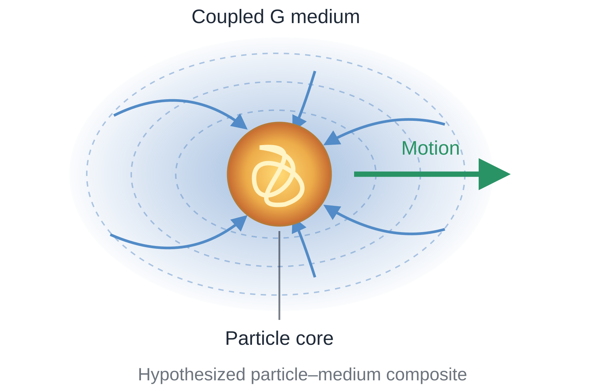

# EX-GC24 proposal — does the G medium generate inertial mass?

**Status: PROPOSED, EXPLORATORY; not approved to run.** PI: Richard Benear. Direction: Claude's EX-GC23 review, with ChatGPT's proposed test design (2026-11-20). Our construction, not LaViolette's. Base: 323dd68 (EX-GC23 reviewed and merged). Execution owner, final settings and budget subject to PI approval. Orbits explicitly deferred.

## Motivation

EX-GC23 demonstrated nearly ballistic chemical-centroid motion after correcting the velocity equation's material derivative. Strong and weak kicks retained 97.06% and 99.81% of their initial internal speed, with the bare absorption drag disabled. Equal external flux produced centroid accelerations within 0.36% for K=.2 and .4, under an assigned inertia proportional to consumption. Claude reproduced the strong runs exactly and cautioned that simply reinstating the bare drag would primarily verify the imposed relaxation time tau=20. **The question is what sets the ratio of inertial mass to absorption drag, not how to tune it.**

Hypothesis: a particle together with a coupled, moving G-field configuration can have an effective inertial response arising from the medium itself, analogous to added mass in hydrodynamics. The medium may resist changing the velocity of the composite even where its steady velocity drag is small. This is a physical analogy, not a claim that G is an ordinary fluid or that this model establishes fundamental inertia.



*Conceptual schematic only; the arrows and halo do not depict a computed solution or prove added mass. The core's knot symbol evokes EX-GC14/15; EX-GC23 itself was a plain chemical particle without a knot.*

## Stage A: prescribed-source mechanical impedance

Begin with the EX-GC22 Gaussian sink, which permits us to isolate the G medium without a prescribed particle mass or deformation. Let S=integral s dV denote total consumption, and prescribe a translation z(t), not a velocity-field kick. Use the shared force proxy Fz=2 integral s Jz/G dV from the existing recoil law, **without dividing by the assigned inertia S tau**. This fixes a model force convention only; a physical momentum normalization would still require a reciprocal medium exchange law.

1. **Steady motion:** reproduce the small-v steady drag, with sign reversal and zero-motion controls. Estimate b from Fz/v and check linearity. Separate the EX-GC22 self-wake component from the EX-GC17 head-on absorption drag, which is a separate interaction and must not simply be omitted from the final comparison.
2. **Acceleration pulse / ramp:** from a correctly relaxed medium, prescribe small positive and negative accelerations; compare the reaction with the calibrated steady drag and evaluate the transient history. A constant-acceleration run alone cannot distinguish a genuine added mass from memory.
3. **Sinusoidal displacement:** prescribe z=A cos(omega t), preferably low amplitudes with an amplitude-convergence check; measure both the in-phase and quadrature components relative to velocity. Use a periodic Fourier solver first (the EX-GC22 mean-source compensation is diagnostic only); verify selected cases by direct time evolution with startup transients removed. With exp(i omega t), define impedance Z=-Fhat/Vhat. Re Z is dissipative resistance and Im Z/omega is a candidate reactive inertial coefficient. Retain the full frequency-dependent response; a positive reactive coefficient at one frequency is not by itself a local, frequency-independent inertia.
4. **Parameter variation:** vary total consumption at fixed source shape, width independently, c, relaxation time tauJ (D=c^2 tauJ), box size and mesh. Confirm low-frequency and large-box sensitivity; check sign, scaling, saturation, and damping. Quantify the decay rate b/m and the timescale m/b where m>0; compare to the separately measured bare absorption drag in the *same force normalization*. Do not conflate tauJ (medium relaxation) with tau=20 (assigned particle response).

The constant-v and harmonic source calculations should be cheap; use them before committing expensive full-particle runs. Negative, zero, nonlocal or frequency-dependent inertial response remains a valid outcome, not a reason to tune mass by hand. Report units, box/boundary conditions, source normalization and probe bandwidth.

## Analytic candidate and discriminator

The EX-GC22 medium obeys G_t=-div J-s, J_t=-c^2 grad G-J/tauJ. Consider a fixed-profile sink, weak depletion (G approximately 1 in the recoil), periodic compensated mean source, and nonzero Fourier modes. With s_hat the rest-source transform, a small displacement xi exp(-i omega t) in z produces delta s_hat=-i k_z xi s_hat. Linearizing both the sampled flux and the translating weights gives

```
Fz_hat / xi = 2 sum_k |s_hat(k)|^2 k_z^2
                 * [c^2/(c^2 |k|^2 - omega^2 - i omega/tauJ) - 1/|k|^2]
```

where the sum includes the Fourier volume normalization, and the zero mode is excluded. The subtraction enforces zero static force on a translated sink. In the lossless, finite-box, sufficiently low-frequency limit this has the leading **positive** acceleration-opposing coefficient

```
m_add = (2/c^2) integral |s_hat(k)|^2 k_z^2 / |k|^4 d^3k/(2 pi)^3
```

using the existing recoil normalization. This is a candidate derived **linear-response proxy**, not a measured result, not a proof of momentum conservation, and not automatically the finite-tauJ, infinite-volume or nonlinear value. Finite relaxation and low modes can yield memory and different signs of the fitted reactive coefficient; test order of limits rather than blindly extrapolating the lossless expression. For sufficiently weak damping and fixed finite box the leading drag has the same integral divided by c^2 tauJ instead of c^2; the ratio of the two proxy coefficients tends to tauJ in that limit. The head-on absorption drag does not obey this formula.

In particular, at unchanged sink shape, m_add and this linear self-wake drag are quadratic in S, whereas the long-range G source is linear in S. That scaling mismatch is a decisive discriminator. If it persists after allowing self-consistent shape and momentum exchange, it is evidence *against* the simple medium-added-mass mechanism yielding universal free fall. Do not fit an absorption-proportional mass normalization to hide it.

## Stage B: medium momentum and physical consistency

If Stage A finds a robust acceleration response, investigate a two-way momentum exchange law. The existing J is a G flux; reinterpreting it as momentum density requires a justified energy/momentum normalization, not just a rename. Establish a ledger for the core, medium, boundary/reservoir, momentum of absorbed G, and any source or damping terms. A linear-wave energy identity can be a useful diagnostic but is not automatically physical total momentum. Distinguish stored, reversible momentum from emitted waves and dissipative absorption. In the lossless/source-free limit require exchange cancellation, and in the open model account explicitly for loss through sinks and walls.

Only then test a full corrected Gc particle with the assigned mass removed or independently varied as a diagnostic, and measure actual W-centroid motion under known force. Compare momentum-change/velocity, impulse-response and harmonic estimates of inertia. Use the EX-GC23 h=.125 subset (paired weak/strong as affordable) to resolve the ~2.5% centroid/flow slip independently of added mass. Check survival and independent rest states. A prescribed-sink reactive force alone does not establish a freely moving massive particle.

## Decisions, budget, and follow-on

- Proposed default exploratory cap: 2 core-hours, <=4 workers, single numerical-library threads; the PI approves execution and allocation. Start with analytic/FFT diagnostics, record a pre-run cohort and measured cost before full chemistry. Boundary and temporal refinement are prerequisites for interpreting an added mass.
- Positive result: reproducible, positive acceleration-opposing response distinct from drag/history, with consistent normalization and scaling. Negative result: vanishing, negative, strongly box-dependent or frequency-dependent response that cannot be interpreted as local mass, or drag incompatible with sustained motion. Report all cases. A separate follow-up would test physical closure even for positive model results.
- Candidate EX-GC25: compare derived inertial mass against gravitational sourcing across independently established particle configurations (do not assign the proportionality). Include self-wake and head-on drag in the same ledger. If a rest-frame medium cannot support acceptable inertia/drag, reconsider a no-preferred-frame formulation explicitly.
- **Defer orbital tests** until inertia and drag are derived and the full particle has a sensible response without imposed tau. No claim of Newtonian, relativistic or quantum physics follows merely from a fitted impedance or a stable orbit.

## Companion illustration and references

The original particle-and-knot conceptual illustration requested by Richard is preserved unchanged in [ModelGc_topological_particle.png](../paper/figures/ModelGc_topological_particle.png), distinct from the new schematic, and from the EX-GC22/23 measured plots. Both are illustrations, not simulation snapshots. The earlier figure represents the degree-one topological texture, W-rich core, G depletion field and inward flux; no event horizon or astrophysical black hole is implied.

Prior work: `results/EX-GC17/EX-GC17_note.md`, `results/EX-GC22/EX-GC22_note.md`, `results/EX-GC23/EX-GC23_note.md`, `review/EX-GC23_claude_review.md`. Hydrodynamic comparison (analogy only): P. M. Lovalenti and J. F. Brady, “The hydrodynamic force on a rigid particle undergoing arbitrary time-dependent motion at small Reynolds number,” [J. Fluid Mech. 256, 561–605 (1993)](https://doi.org/10.1017/S0022112093002885).
